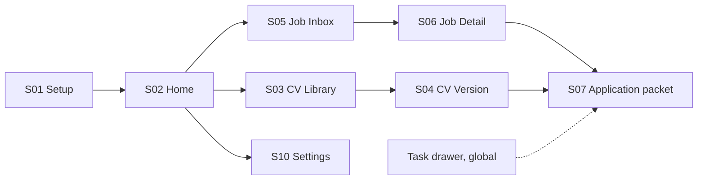
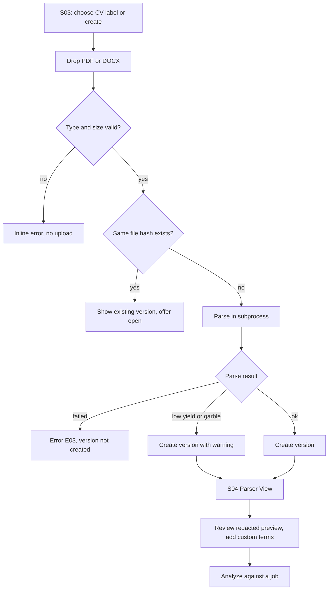
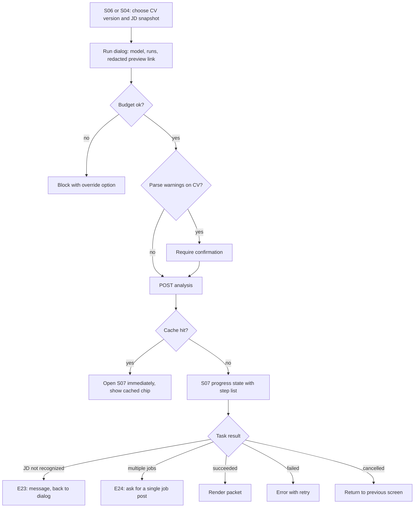

# AFD.md — App Flow Documentation

Companion to PRD.md and DESIGN.md. Defines screens, navigation, flows, states, validations and edge cases. IDs (S##, F##, E##) are stable references for tickets and tests.

## 1. Actors and entry points
- **User:** the single local user. No login; the app is reachable only on 127.0.0.1.
- **System actors:** Worker (background tasks), Gmail MCP server, LLM provider.
- **Entry points:** first launch (S01 Setup), subsequent launches (S02 Home), deep links to analyses and comparisons.

## 2. Route map and navigation

| Route | Screen |
|---|---|
| `/setup` | S01 Setup wizard (first run only) |
| `/` | S02 Home |
| `/cvs` | S03 CV Library |
| `/cvs/:cvId/versions/:versionId` | S04 CV Version and Parser View |
| `/jobs` | S05 Job Inbox |
| `/jobs/:jobId` | S06 Job Detail |
| `/analyses/:analysisId` | S07 Application packet |
| `/settings/:tab` | S10 Settings (`criteria`, `llm`, `privacy`, `gmail`) |
| `/compare`, `/benchmarks` | S08, S09: deferred (Could) |

## 3. Screen inventory

| ID | Screen | Purpose | Primary actions | Key APIs |
|---|---|---|---|---|
| S01 | Setup wizard | Configure LLM, connect Gmail, set criteria | Test connection, Connect Gmail, Save | `PUT /api/settings`, `POST /api/gmail/connect`, `GET /api/health` |
| S02 | Home | Next actions, latest analyses, system status | Jump to task | `GET /api/health`, `GET /api/jobs`, `GET /api/analyses` |
| S03 | CV Library | List CV labels and versions | Create label, Upload version | `GET/POST /api/cvs`, `POST /api/cvs/{id}/versions` |
| S04 | CV Version | Parser View, redaction preview, notes | Analyze against job, Delete | `GET /api/cv-versions/{id}`, `GET /api/cv-versions/{id}/parser-view`, `DELETE /api/cv-versions/{id}` |
| S05 | Job Inbox | Triage jobs | Sync alerts, Add manually, Add JD, Dismiss, Shortlist | `POST /api/jobs/sync-alerts`, `GET/POST/PATCH /api/jobs`, `POST /api/jobs/{id}/snapshots` |
| S06 | Job Detail | JD snapshots, run analysis, per-job history, outcome | Paste JD, Run analysis, Set outcome | `POST /api/jobs/{id}/snapshots`, `POST /api/analyses`, `GET /api/jobs/{id}/history`, `PATCH /api/jobs/{id}` |
| S07 | Application packet | Summary, matches, gaps, suggestions, cover note, structured JD | Accept/Reject, Exclude requirement, Edit/Copy/Regenerate cover note, Export, Re-run | `GET /api/analyses/{id}`, `PATCH /api/suggestions/{id}`, `PATCH /api/requirements/{id}`, `PATCH /api/analyses/{id}/cover-note`, `POST /api/analyses/{id}/cover-note/regenerate`, `GET /api/analyses/{id}/export.md` |
| S08 | Compare | Deferred (Could) | — | — |
| S09 | Benchmarks | Deferred (Could) | — | — |
| S10 | Settings | Criteria, LLM, privacy, Gmail | Save, Delete data, Backup, Export | `GET/PUT /api/settings`, `POST /api/backup`, `POST /api/data/purge`, `GET /api/data/export` |

Global component: **Task drawer** (polls `GET /api/tasks/{id}` every 1–2 s, cancel via `POST /api/tasks/{id}/cancel`).

## 4. Core flows

### F01 First-run setup
**Trigger:** first launch (no settings stored).
**Steps:** 1) Enter LLM base URL, model, API key (stored in keychain). 2) "Test connection" calls a minimal LLM request. 3) Optionally connect Gmail (OAuth, read-only; scope displayed). 4) Enter job criteria (can skip). 5) Review the privacy summary: what is sent, what stays local. 6) Finish → S02 Home.
**Alternates:** Gmail skipped → manual job entry only, banner on S05. LLM test fails → show error code, stay on step.
**Postconditions:** settings stored, health green or explained.

### F02 Upload CV

**Postconditions:** new version with `version_no`, parser report and redacted text; nothing sent to the LLM yet.

### F03 Sync job alerts
**Trigger:** "Sync alerts" on S05 (or optional scheduled sync, Could).
**Steps:** 1) Backend lists new alert emails via MCP. 2) Each email is parsed into job cards. 3) Jobs are normalized, deduplicated and pre-filtered. 4) UI shows summary counts. 5) Parse failures are listed.
**Alternates:** Gmail not connected → prompt to connect. Token expired → E15. No new emails → "No new alerts since [time]".
**Postconditions:** jobs stored with status `new` or `filtered`; last-sync time updated; sync is idempotent.

### F04 Triage a job
**Steps:** 1) Open S05. 2) For each row: Shortlist, Dismiss, or Open (S06). 3) Filtered jobs can be shown and overridden. 4) Dismiss shows an Undo toast.
**Postconditions:** status updated.

### F05 Add a JD snapshot (paste the whole page)
**Trigger:** "Add JD" on S05/S06, or "Save and run analysis" from the dialog.
**Steps:** 1) In the user's own browser, open the job post and expand collapsed description text. 2) Select all and copy. 3) Paste into the Add JD dialog; no cleanup needed. 4) Live checks: length 200–60,000 characters, truncation heuristic, multiple-jobs heuristic, injection-phrase heuristic. 5) Save: an immutable snapshot is created, hash stored, `source_kind` recorded. 6) Editing the text later creates a new snapshot and keeps the old one.
**Alternates:** too short → blocked (E07); instruction-like phrases → visible flag (E08); possible truncation → warning (E27); the dialog never fetches a URL.
**Postconditions:** snapshot stored; the job is ready for analysis.

### F06 Generate the application packet

**Progress:** after `POST /api/analyses` returns 202, S07 polls `GET /api/tasks/{id}` every 1–2 seconds and shows the current step (Reading the job post, Matching run 1 of 3, Writing suggestions, Writing cover note, Finalizing). Polling stops on a terminal status. A cache hit returns 200 with the existing analysis id. Leaving the page does not cancel the task.
**Postconditions:** analysis stored with provenance; job status becomes `analyzed`.

### F07 Review the application packet
**Steps:** 1) Check "Job as read": confirm the role, requirements and quotes were understood correctly; exclude any wrong requirement (the score recomputes). 2) Read the constraint flags. 3) Read the Summary. 4) Go through What matches, then What does not match: expand a row for evidence, rationale and agreement; "Locate in CV" highlights the quote. 5) Review CV suggestions: accept or reject each, optionally with a reason. 6) Review the cover note: edit, copy or regenerate. 7) Export the packet as Markdown. 8) Apply manually in the user's own browser. 9) Optionally set the job status to applied and record the outcome later.
**Alternates:** guard-rejected suggestions are hidden by default with a toggle; ungrounded evidence rows read "Evidence could not be verified; treated as a gap"; a rejected cover note shows "Draft could not be verified" with Retry (E25).
**Postconditions:** decisions stored; no CV file and no external site is modified by the tool.

### F08 Iterate: revise the CV and re-check a job
**Steps:** 1) Edit the CV outside the tool using accepted suggestions. 2) Upload it as a new version under the same label (F02), with an optional note. 3) Open the same job and choose "Re-run with CV v4". 4) The History card lists analyses of this job per CV version with strong/partial/gap counts. 5) Entries with a different model or prompt version are marked "not comparable".
**Postconditions:** version history extends; older analyses are retained.

### F09 Benchmark and compare (deferred)
Part of Could (FR-18–21). Not in the MVP. The earlier draft of this flow returns when promoted.

### F10 Manage benchmark sets (deferred)
Part of Could. Not in the MVP.

### F11 Eval (supporting, CLI only)
**Steps:** the user writes gold labels as YAML files under `eval/gold/`; the eval CLI reports agreement, stability, ungrounded rate, JD structuring accuracy and cost, and exits non-zero on regression. The UI has no gold-label screen in the MVP.

### F12 Settings, privacy and data
**Steps:** edit criteria, LLM settings, custom redaction terms; connect/disconnect Gmail; create backup; export data as JSON; delete individual items; purge all (typed confirmation `DELETE`).
**Alternates:** Changing `LLM_MODEL` shows a notice: "Existing analyses used a different model and cannot be compared with new ones until re-run."

## 5. State models

**Analysis task:** `queued → running → succeeded | failed | cancelled`; `running → queued` on stale recovery; `failed → queued` on user retry.
**Job posting:** `new → shortlisted | dismissed`; `shortlisted → analyzed | dismissed`; `analyzed → applied` (manual flag); `dismissed → new` (restore).
**CV version:** `parsed_ok | parsed_warning | parse_failed (not stored)`.
**Suggestion:** `pending → accepted | rejected`; `auto_rejected` (guard) is terminal and hidden by default.
**Job outcome:** `applied_at` and `outcome` (none, no_response, rejected, interview, offer) are plain fields on the job, not states of the status machine.
**Cover note:** `generated → edited`; or `rejected_<rule>` after two failed guard checks.
**Comparison (Could):** `valid | invalid(reasons) | incomplete(missing analyses)`; not in the MVP.

## 6. Validation rules

| Field | Rule |
|---|---|
| CV file | PDF or DOCX; ≤ 5 MB; magic bytes match extension. |
| CV text | ≥ 300 chars after extraction (else warning); ≤ 30,000 chars (else reject with guidance). |
| Labels, notes | Label ≤ 60 chars; version note ≤ 200 chars. |
| LLM base URL | HTTPS, or localhost for local servers. |
| Runs | Integer 1–5 (default 3). |
| Criteria lists | ≤ 50 entries per list, entries ≤ 60 chars. |
| Custom redaction terms | ≤ 100 terms, each ≥ 2 chars. |
| JD text | 200–60,000 chars. |
| Cover note | 60–150 words, English. |
| Non-negotiables | Languages ≤ 10 entries; locations ≤ 20 entries; salary floor numeric with currency. |
| Benchmark set (Could) | ≥ 3 JDs required to run a comparison; at least 1 holdout recommended. |

## 7. Error and edge-case catalog

| ID | Trigger | System behavior | User-facing message (pattern) | Recovery |
|---|---|---|---|---|
| E01 | Duplicate CV hash | 409, no new version | "This file already exists as version N." | Open existing version. |
| E02 | No text layer (scanned PDF) | Parse warning | "No selectable text found. This tool cannot read scanned PDFs." | Export a text-based PDF and re-upload. |
| E03 | Parser crash/timeout | Subprocess killed, nothing stored | "The file could not be read." | Try another export. |
| E04 | Multi-column garble suspected | Warning on version | "Text order may be scrambled; check the extracted text." | Review Parser View; simplify layout. |
| E05 | Alert email unrecognized | Count + id listed | "1 email could not be parsed." | Add job manually. |
| E06 | Duplicate job | Merged silently, counted | "2 duplicates skipped." | None needed. |
| E07 | JD too short | Save blocked | "JD is under 200 characters; paste the full description." | Paste more text. |
| E08 | Injection phrases in JD/email | Flag only; pipeline unchanged | "This text contains instruction-like phrases. It is treated as data." | None needed. |
| E09 | LLM unreachable | Retries, then fail step | "The model did not respond. No result was produced." | Retry; check Settings. |
| E10 | Invalid LLM JSON | Repair retries, then fail | "The model returned an unreadable result." | Retry; report if repeated. |
| E11 | Ungrounded evidence | Verdict downgraded to gap | "Evidence could not be verified; treated as a gap." | Review manually. |
| E12 | Low agreement | Requirement flagged unstable | "Runs disagreed (1/1/1)." | Mark own verdict; re-run. |
| E13 (Could) | Model string changed | Comparison invalid | "A and B were analyzed with different models." | Re-run A with current settings. |
| E14 (Could)  | Prompt bundle changed | Comparison invalid | "Prompt version differs." | Re-run affected analyses. |
| E15 | Gmail token revoked/expired | Sync blocked | "Gmail access expired." | Reconnect Gmail. |
| E16 | Budget exceeded | New tasks blocked | "Monthly token budget reached." | Raise budget or override once. |
| E17 | Worker crash mid-task | Task requeued after timeout | Task shows "Resumed." | None needed. |
| E18 | Delete CV version used in analyses or gold labels | Confirmation lists impact | "This also deletes 7 analyses and 12 gold labels." | Confirm or cancel. |
| E19 | Delete JD snapshot in a benchmark set | Confirmation lists sets | "This snapshot is in 2 benchmark sets." | Remove from sets first or confirm. |
| E20 | Browser closed mid-task | Task continues server-side | Drawer shows task on return | None needed. |
| E21 (Could)  | Benchmark has < 3 JDs | Compare disabled | "Add at least 3 job descriptions." | Add JDs. |
| E22 | SQLite locked/corrupt | Health shows error; writes blocked | "The database cannot be written." | Restore from backup. |
| E07 | JD too short | Save blocked | "The text is under 200 characters. Paste the full job page." | Paste more text. |
| E23 | No job description found in pasted text | Task stops after structuring; matching is skipped | "I could not find a job description in this text." | Paste the job post text. |
| E24 | Several distinct jobs in the text | Task stops | "This looks like a list of jobs. Paste one job post." | Open a single job and paste it. |
| E25 | Cover note failed the guard twice | Rest of the packet unaffected | "Draft could not be verified." | Retry or write your own. |
| E26 | Blocked or private host in a URL (Could, FR-34) | Request refused | "This address cannot be fetched." | Paste the text instead. |
| E27 | Text may be truncated | Non-blocking warning | "This text may be cut off." | Expand collapsed text and paste again. |
> **Could (deferred):** E13, E14 and E21 apply only when benchmarks and comparison (FR-18–21) are built.

## 8. Feedback and notification rules
- **Toasts** for completed quick actions; errors that need action persist until dismissed.
- **Banners** for page-level states (invalid comparison, Gmail disconnected, budget reached).
- **Task drawer** is the single place for long-running progress; it does not use modal blocking.
- **No email, push or sound notifications.** The app is local.
- Progress steps use plain names: "Extracting requirements", "Matching run 2 of 3", "Writing suggestions", "Finalizing".

## 9. Keyboard
No custom shortcuts in MVP (Could). The app must be fully operable with standard keyboard behavior: logical tab order, Enter/Space to activate, Esc to close dialogs and popovers, visible focus. See DESIGN.md section 12.

## 10. Data lifecycle and permissions
- No accounts; access control is network-level (127.0.0.1 only).
- Data classes: CV files and text, JD snapshots, analyses, settings, logs (metadata only), backups.
- Retention: keep until the user deletes; optional auto-purge is an open question in PRD.
- Deletion cascades are always previewed (E18, E19). Purge-all requires typed confirmation.
- Backups are stored in `DATA_DIR/backups`; restore is a CLI operation in MVP.

## 11. First-run and empty states

| Screen | Empty state |
|---|---|
| S02 Home | "Set up the tool" checklist (LLM, Gmail optional, first CV). |
| S03 | "No CV yet. Upload a PDF or DOCX." |
| S05 | "No jobs yet. Sync alerts or add one manually." |
| S06 | "No job description yet. Paste the whole job page to analyze this job." |
| S07 | Not reachable without an analysis; a deep link to a missing analysis shows "Analysis not found". |
| S08, S09 | Deferred (Could); no empty states in the MVP. |

## 12. Traceability

| Flow | Requirements |
|---|---|
| F01 | FR-24, 25, 28 |
| F02 | FR-01, 02, 03 |
| F03 | FR-06, 07 |
| F04 | FR-07, 10 |
| F05 | FR-08, 09 |
| F06 | FR-11–15, 17, 29, 30, 32 |
| F07 | FR-13–16, 30–33 |
| F08 | FR-01, 33 |
| F09, F10 | FR-18–21 (Could) |
| F11 | FR-23 |
| F12 | FR-24, 26, 28 |

## 13. Open items
- Real alert-email samples (5–10) to finalize S05 parse-failure copy and E05.
- Real pasted job pages (about 15, kept local) to finalize the structuring prompt and the truncation and multiple-jobs heuristics.
- Decide default `MATCH_RUNS` (3 or 1) after measuring latency.
- Decide which non-negotiables ship in the MVP, and confirm outcome tracking fields.
- Decide default retention policy and whether scheduled sync is in the MVP.