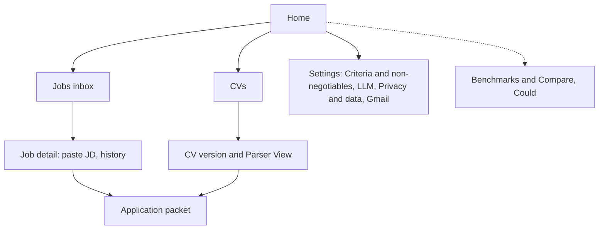

# DESIGN.md — UI/UX Guidelines

Companion to PRD.md and AFD.md. Desktop-first local web app (React, Vite, TypeScript).

## 1. Principles

| ID | Principle | Consequence |
|---|---|---|
| P1 | Evidence before verdict | Every verdict is shown with the CV quote that supports it, or an explicit "no evidence found". |
| P2 | Honest precision | Show counts (9 strong, 4 partial, 3 gaps) and whole-number coverage. No gauges, no decimals, no "match %" hero. |
| P3 | Calm density | Information-rich but quiet: neutral surfaces, one accent, color reserved for meaning. |
| P4 | Visible trust | Always show what leaves the machine, which model produced a result, and whether it was cached. |
| P5 | No decoration | No gradients, emoji decoration, illustrations, filler data or celebratory animations. |
| P6 | Reversible actions | Destructive actions confirm, list consequences, and (where possible) offer undo. |
| P7 | Comparable when asked | History across CV versions is shown only when the analyses are comparable (same model and prompt version), and says why when they are not. Cross-job benchmarking is Could. |

## 2. Context of use
Single user, 1280–1920 px desktop, long sessions, light and dark mode following the system. Minimum supported width 1024 px; below that, layouts collapse to a single column but mobile is not a target.

## 3. Information architecture

Primary nav (left rail): Home, CVs, Jobs, Settings. A task drawer (bottom-right) shows running and recent tasks from anywhere. Benchmarks and Compare appear in the nav only when built.

## 4. Layout system
- **App shell:** left rail 240 px (collapsible to 64 px), top bar 56 px, content area scrolls.
- **Top bar:** page title, active CV version selector, model badge (e.g. `deepseek-v4-flash`), task indicator.
- **Content width:** reading/forms max 960 px; tables and compare views fluid up to 1440 px.
- **Grid:** 12 columns, 24 px gutters at ≥ 1280 px; 16 px below.
- **Breakpoints:** 1024, 1280, 1536.
- **Page templates:** (a) list + filters, (b) detail (header, summary strip, tabs), (c) split view (list left 40%, detail right 60%), (d) form (single column).

## 5. Design tokens

All colors are CSS variables on `:root` and `[data-theme="dark"]`. Components never use raw hex.

### 5.1 Color
| Token | Light | Dark | Use |
|---|---|---|---|
| `--bg` | #FFFFFF | #0F172A | App background |
| `--bg-subtle` | #F8FAFC | #111C33 | Panels, table headers |
| `--border` | #E2E8F0 | #1E293B | Dividers, inputs |
| `--text` | #0F172A | #F1F5F9 | Primary text |
| `--text-muted` | #475569 | #94A3B8 | Secondary text |
| `--accent` | #0F766E | #2DD4BF | Primary actions, links, focus ring |
| `--accent-hover` | #115E59 | #5EEAD4 | Hover |
| `--accent-subtle` | #F0FDFA | #042F2E | Selected rows |
| `--strong-fg / bg / border` | #15803D / #F0FDF4 / #BBF7D0 | #4ADE80 / #052E16 / #166534 | Verdict: strong |
| `--partial-fg / bg / border` | #92400E / #FFFBEB / #FDE68A | #FBBF24 / #451A03 / #92400E | Verdict: partial |
| `--gap-fg / bg / border` | #B91C1C / #FEF2F2 / #FECACA | #F87171 / #450A0A / #991B1B | Verdict: gap |
| `--unstable-fg / bg` | #334155 / #F1F5F9 | #CBD5E1 / #1E293B | Low agreement flag |
| `--danger` | #B91C1C | #F87171 | Destructive actions, errors |

Contrast rules:
- Text must reach 4.5:1 (3:1 for large text and UI boundaries). Computed on white: accent #0F766E ≈ 5.5:1, strong #15803D ≈ 5.0:1, gap #B91C1C ≈ 6.5:1, partial #92400E ≈ 7.1:1.
- Verdict-on-tint pairings and all dark-mode pairings must be verified with a contrast checker in CI before release. Treat the values above as starting points, not as verified.
- Color never carries meaning alone: every verdict has an icon and a text label.

### 5.2 Typography
System fonts only (no external font loading: privacy, offline, speed).
- Sans: `ui-sans-serif, system-ui, -apple-system, "Segoe UI", Roboto, sans-serif`
- Mono (quotes, hashes, versions): `ui-monospace, SFMono-Regular, Menlo, Consolas, monospace`

| Role | Size / line height | Weight |
|---|---|---|
| Page title | 24 / 32 | 600 |
| Section title | 18 / 28 | 600 |
| Body | 16 / 24 | 400 |
| Dense table / UI | 14 / 20 | 400, 500 for headers |
| Caption / meta | 12 / 16 | 400 |
| Quote (mono) | 13 / 20 | 400 |

Tabular numerals for counts and tables (`font-variant-numeric: tabular-nums`). Max line length 75 characters for reading text.

### 5.3 Spacing, shape, elevation, motion
- Spacing scale: 4, 8, 12, 16, 24, 32, 48, 64.
- Radius: 4 (inputs, badges), 6 (buttons), 8 (cards, dialogs).
- Elevation: borders instead of shadows; one soft shadow only for popovers, menus and dialogs.
- Motion: 120 ms (hover, toggles), 200 ms (panels, drawers), ease-out. No bounce, no decorative animation. All motion disabled under `prefers-reduced-motion`.
- Z-index layers: content 0, sticky header 10, drawer 20, popover 30, dialog 40, toast 50.

### 5.4 Iconography
One outline icon set (e.g. Lucide), 16 px in dense UI and 20 px elsewhere, stroke 1.5. Verdict icons: check (strong), half-circle (partial), x (gap). Icons come from the set, never emoji. Icon-only buttons need an accessible name and a tooltip.

## 6. Components

| Component | Purpose | Variants / states | Accessibility notes |
|---|---|---|---|
| Button | Actions | primary, secondary, ghost, danger; sm/md; loading, disabled | Loading keeps width; `aria-busy`; disabled explains why via tooltip on focus. |
| FileDropzone | CV upload | idle, drag-over, uploading, error | Keyboard-activatable; announces result via live region; shows accepted types and size limit. |
| VerdictBadge | Strong / Partial / Gap | with icon + label; compact and full | Never color-only; `aria-label="Verdict: Gap"`. |
| ImportanceTag | Must / Nice | neutral outline | Text label always visible. |
| CountsBar | Strong/partial/gap distribution | horizontal stacked bar with legend and numbers | Legend and numbers are the primary data; bar is supplementary. |
| RequirementRow | One requirement | collapsed, expanded, unstable, ungrounded, deactivated | Expand with Enter/Space; `aria-expanded`. |
| EvidenceQuote | Verbatim CV quote | highlighted in CV viewer, mono | "Locate in CV" scrolls and focuses the highlight. |
| AgreementIndicator | "3/3 runs agree" | agree, split | Text first; icon secondary. |
| SuggestionCard | Original vs proposed | pending, accepted, rejected, auto-rejected by guard | Accept/Reject are buttons with visible labels; keyboard shortcuts optional. |
| DiffView | Original vs proposed text inside suggestions | inline, side-by-side | Additions/removals marked with +/− and underline, not color only. CV version diff is Could. |
| TaskDrawer | Running/recent tasks | collapsed, expanded | Polls task status every 1–2 s; `aria-live="polite"` for progress; cancel buttons labeled. |
| ProvenanceChip | Model, prompt bundle, runs, date, cached | default, mismatch | Mismatch variant states what differs. |
| TrendChart | Versions over time | line/bar with direct labels and data table toggle | Table alternative; patterns/labels not color-only. |
| TaskDrawer | Running/recent tasks | collapsed, expanded | `aria-live="polite"` for progress; cancel buttons labeled. |
| RedactionPreview | Exact text sent to LLM | with redaction tokens highlighted | Read-only text with copy button. |
| ConfirmDialog | Destructive confirm | lists consequences, requires typed word for purge | Focus trap; Esc closes; initial focus on safe action. |
| EmptyState | No data yet | title, one sentence, one primary action | No illustration. |
| Skeleton | Loading | row/card skeletons | Respect reduced motion (static shimmer-free). |
| Toast | Brief confirmations | success, error (persistent) | `role="status"` / `role="alert"`. |
| SummaryCard | Fit label, counts, must-have coverage, strongest matches, biggest gaps, unstable count | default, with knockout gaps | Counts and labels are primary text; no gauge, no percentage hero; items link to requirement rows. |
| ConstraintFlag | Non-negotiable versus what the post states | ok, conflict, review, not stated | Text label always visible; ok uses the strong palette, conflict the gap palette, review the partial palette, not stated the neutral palette; icon plus text, never color alone; informational only. |
| SectionNav | Sticky anchors inside the packet | default, active | Anchor links with `aria-current`; keyboard operable. |
| JobReadingPanel | "How I read this job post": structured JD for a quick check | collapsed, expanded, warning | Expanded automatically when there are warnings; shows the quote behind each item; each requirement can be excluded. |
| CoverNoteEditor | Draft cover note | draft, edited, rejected by guard | Labeled "Draft"; word count; Copy and Regenerate buttons with visible labels; rejected state explains why in plain words. |

## 7. Screen specifications

### 7.1 Home
Purpose: where to act next. Three blocks, no marketing content:
1. **Next actions:** "3 new jobs to triage", "Analysis failed: retry", "Job post pasted, not yet analyzed".
2. **Latest packets:** table (job, CV version, strong/partial/gap counts, fit label, date).
3. **System status:** Gmail connected, LLM reachable, database writable, last backup.

### 7.2 Job Inbox
```
+------------------------------------------------------------------+
| Jobs                          [Sync alerts]  [+ Add manually]    |
| Filters: [New v] [Source v] [Filtered out v]     Search /        |
+------------------------------------------------------------------+
| Title                 Company     Location   Received  Status     |
| Senior Backend Eng    Acme        Remote     Nov 6     New        |
|   Matches: "backend", remote                    [Add JD] [Dismiss]|
| Data Engineer         Globex      Jakarta    Nov 5     Filtered   |
|   Filtered by: exclude "contract"          [Show anyway]          |
+------------------------------------------------------------------+
| Last sync Nov 7 09:12 · 14 new · 2 duplicates · 1 parse failure  |
+------------------------------------------------------------------+
```
Parse failures are listed with the message id and a "Add manually" shortcut. Rows with no JD snapshot show "Add JD to analyze".
Row actions: **Add JD** (opens the paste dialog, 7.7), **Dismiss**, **Shortlist**. A row with a JD snapshot shows **Open packet** or **Run analysis**. The top of the list may include a one-line hint: "Open the job post, expand the description, select all, copy, then Add JD."

### 7.3 CV version and Parser View
Left: file metadata, version note, warnings. Right: tabs **Extracted text**, **Sections**, **Sent to LLM (redacted)**. Warnings appear above tabs with severity and a plain explanation (for example "Looks like two columns; text order may be scrambled"). Primary action: "Analyze against a job".

### 7.4 Application packet
A single scrolling page with a sticky section nav and a sticky CV viewer on the right. Sections in this order:

```
+-------------------------------------------------------------------------+
| Senior Backend Engineer · Acme · Remote            CV: Backend v3 [v]   |
| [deepseek-v4-flash] [prompt a1b2c3] [3 runs] [Nov 9 10:41] [cached]      |
| Nav: Summary | Matches | Gaps | Suggestions | Cover note | Job as read   |
+---------------------------------------------+---------------------------+
| CONSTRAINTS                                 | CV viewer                 |
| Language: English required - ok             | "...built Python          |
| Salary: stated, review                      |  services for 6 years..." |
| Work mode: remote - ok                      |  (highlighted quote)      |
+---------------------------------------------+                           |
| SUMMARY      Reasonable fit                 |                           |
| Strong 9   Partial 4   Gap 3               |                           |
| Must-haves covered 7 of 9 · 2 knockout gaps |                           |
| Strongest: Python 5+ yrs · REST APIs · SQL  |                           |
| Biggest gaps: Kubernetes (must) · Terraform |                           |
| 2 requirements unstable                     |                           |
+---------------------------------------------+                           |
| WHAT MATCHES (9)                            |                           |
| [check] Python 5+ yrs   Must  3/3 agree     |                           |
|   evidence: "..." [Locate in CV]            |                           |
| WHAT DOES NOT MATCH (7)                     |                           |
| [x] Kubernetes   Must   Gap   3/3           |                           |
| [half] Kafka     Must   Partial   2/3 !     |                           |
|   [Exclude from score]                      |                           |
| CV SUGGESTIONS (6)   [General] [This job]   |                           |
|   original vs proposed, guard status,       |                           |
|   [Accept] [Reject]                         |                           |
| COVER NOTE (draft)                          |                           |
|   editable text · 118 words                 |                           |
|   [Copy] [Regenerate]                       |                           |
| JOB AS READ (collapsed)                     |                           |
|   structured JD with quote per item         |                           |
| [Export packet as Markdown]                 |                           |
+---------------------------------------------+---------------------------+
```
(Glyphs are wireframe stand-ins; production uses the icon set.) Rules:
- The Summary is assembled from verified matches only; it contains no free-form model prose.
- "What does not match" lists knockout gaps first, then other gaps, then partials.
- Suggestions are filterable by scope (`General` improves the master CV; `This job` reorders or emphasizes for this post). Guard-rejected suggestions are hidden by default with a "Show rejected by guard" toggle.
- The cover note is shown only when it passed the guard; otherwise the section says "Draft could not be verified" and offers Retry.
- "Job as read" opens automatically when parsing produced warnings.
- If this job has earlier analyses, a small History card under the Summary lists counts per CV version, with a "not comparable" note where model or prompt differ.

### 7.5 Compare and Benchmarks (Could, deferred)
Not part of the MVP. The design in the earlier draft (version selectors, validity banner, tuning/holdout deltas) returns when FR-18–21 are promoted. Until then the per-job History card on the packet is the only comparison surface.

### 7.6 Settings
Tabs: **Criteria** (include/exclude keywords, locations, seniority for pre-filtering, plus **Non-negotiables**: languages, salary floor, work mode, locations, work authorization notes; stated as a local mirror, not synced with LinkedIn), **LLM** (base URL, model, runs, concurrency, budget), **Privacy and data** (custom redaction terms, what is sent, delete/purge/export/backup), **Gmail** (connect state, scope shown as read-only).

### 7.7 Add JD dialog
- Large text area labeled "Paste the whole job page". Helper text: "Open the job post, expand the description if it is collapsed, select all, copy, and paste here. No cleanup needed."
- Live character count (200–60,000) and inline warnings: "This looks cut off", "This looks like a list of jobs", "This text contains instruction-like phrases; it is treated as data."
- Buttons: **Save** and **Save and run analysis**. The structured result appears in the packet, not in the dialog.
- The dialog never offers to fetch a LinkedIn URL.

## 8. Interaction patterns
- **Async tasks:** starting an analysis immediately navigates to the Analysis page in a progress state showing steps (Extracting requirements, Matching run 1 of 3, Writing suggestions, Finalizing). Progress comes from polling the task every 1–2 s; polling stops on a terminal status. Leaving the page never cancels the task; the drawer tracks it.
- **Optimistic updates:** only for reversible decisions (accept/reject suggestion, status changes). Failures roll back with a toast.
- **Destructive actions:** ConfirmDialog states exactly what is deleted (counts of analyses, labels). Purge-all requires typing `DELETE`.
- **Undo:** toast with "Undo" for dismiss and reject for 8 seconds.
- **Bulk actions:** multi-select in Job Inbox for dismiss/shortlist only.
- **Keyboard:** standard operability only (logical tab order, Enter/Space to activate, Esc to close dialogs and popovers, visible focus). Custom shortcuts are Could.

## 9. States catalog
| State | Treatment |
|---|---|
| Loading | Skeletons shaped like final content; no spinners over content areas. |
| Empty | EmptyState with the one next action (for example "Upload your first CV"). |
| Error | Inline message with cause, impact, and recovery action; error code in small text. |
| Partial | Banner naming what is missing (for example 3 of 12 analyses not run) with a run action. |
| Invalid comparison | ValidityBanner with reasons; data hidden, not dimmed. |
| Stale cache | ProvenanceChip shows date; "Re-run" available. |
| Ungrounded | Row marked "Evidence could not be verified; treated as gap". |
| Unstable | Row marked with agreement (for example 1/1/1) and a plain-language note. |
| JD not recognized | Packet not created; a message says what was pasted and asks for the job description text; no model cost beyond the structuring call. |
| Multiple jobs detected | Message asks the user to paste a single job post; the pasted text stays in the dialog. |
| Possibly truncated | Non-blocking warning at save time with a hint to expand collapsed text and paste again. |
| Cover note rejected | Section shows "Draft could not be verified" with the reason in plain words and a Retry action. |
| Constraint conflict | Flag shown above the Summary; nothing is hidden, blocked or skipped. |

## 10. Content and microcopy
- Voice: plain, specific, neutral. No hype, no cheerleading, no "AI-powered".
- Terms: use **Gap**, **Partial**, **Strong**; **Must-have** and **Nice-to-have**; **Evidence**; **Version**; **Benchmark**; **Holdout**. Avoid "score" in headings; use "Coverage".
- Error formula: what happened, what it means, what to do. Example: "Gmail access expired. New jobs cannot be synced until you reconnect. Reconnect Gmail."
- Never imply prediction: avoid "chance", "likely to be hired", "ATS score".
- Suggestions never say "add experience". Gaps read: "No evidence in this CV. If you have this experience, add it truthfully; if not, consider it a real gap."
- Sentence case everywhere; no exclamation marks; no emoji.
- Cover note section label: "Draft. Review before sending." Never describe it as ready, perfect or optimized.
- Constraint flags use the post's wording where possible: "Not stated in the post", "The post asks for Japanese; your profile lists English only."
- Summary wording is factual: "7 of 9 must-haves covered", not "Great match!".
- No "apply" or "skip" language anywhere.

## 11. Data visualization rules
- MVP is tables and counts first. The only chart is the CountsBar (stacked bar with numbers and legend).
- Trend charts are Could (FR-21). If built later: direct labels over legends, a data-table alternative, Y axes starting at zero, and the line broken (with an explanation) wherever a comparison is invalid.
- Color always pairs with an icon or pattern and is limited to the verdict palette.
- Show N on every chart or summary (for example "12 JDs, 3 runs each").

## 12. Accessibility (WCAG 2.2 AA)
- Full keyboard operation; visible focus ring (2 px accent, 2 px offset, ≥ 3:1 against neighbors).
- Target size ≥ 24×24 px (aim 32 px for primary controls).
- Logical heading order; landmarks (`nav`, `main`, `aside`).
- Live regions for task progress and toasts; no focus stealing.
- Respect `prefers-reduced-motion` and `prefers-color-scheme`.
- Zoom to 200% without loss of function; text reflows.
- Forms: visible labels, inline errors tied with `aria-describedby`, no placeholder-only labels.
- Test with keyboard-only and one screen reader pass before release.

## 13. Privacy and trust UX
- **Sent-to-LLM preview** is one click from any analysis action; the payload is byte-identical to the preview.
- A persistent but quiet "Data leaves this machine: redacted text to [provider host]" note in Settings and on the Run dialog.
- No third-party assets, fonts, analytics or error reporting.
- Deleting is real: Settings lists what exists and how to remove each class of data.

## 14. Frontend implementation notes
- Stack: React, Vite, TypeScript, React Router, TanStack Query, Radix UI primitives with Tailwind configured to the tokens above (shadcn/ui components allowed as a starting point, restyled to these tokens).
- The production build is static files served by the FastAPI process; no separate frontend server and no SSR.
- Task progress uses TanStack Query `refetchInterval` (1–2 s) that stops on a terminal status. No SSE or WebSocket.
- Markdown/text from the API is rendered escaped or through a sanitizer; never `dangerouslySetInnerHTML`.
- Generated TypeScript client from the OpenAPI schema.
- Component tests with Testing Library; Playwright for core flows; axe checks in CI; contrast checks on the token pairs.

## 15. Anti-slop checklist (apply in review)
- No gradient hero, no decorative blobs, no emoji as decoration or in headings.
- No filler data in tables or placeholder statistics; empty means empty.
- No three-card marketing layouts; no testimonial or pricing patterns.
- Buttons say what they do ("Run analysis", not "Get started").
- One accent color; verdict colors only for verdicts.
- Copy contains no chatbot closers, no hype vocabulary, no invented numbers.

## 16. Release QA checklist
- [ ] All token pairs pass contrast in light and dark.
- [ ] Every verdict and constraint flag readable without color.
- [ ] Keyboard-only walkthrough of F02, F05, F06, F07 (see AFD.md).
- [ ] Empty, loading, error and partial states exist for each screen; JD-not-recognized, multi-job and cover-note-rejected states exist on the packet and dialog.
- [ ] Redaction preview equals the sent payload.
- [ ] No network request leaves for hosts other than the configured LLM and Google APIs; none to LinkedIn.