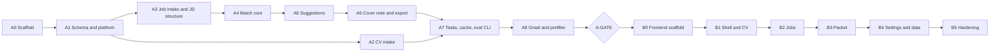

# IMPLEMENTATION PLAN — CV–Job Fit Analyzer

| Field        | Value                                                                                                                                                                          |
| ------------ | ------------------------------------------------------------------------------------------------------------------------------------------------------------------------------ |
| Version      | 0.1                                                                                                                                                                            |
| Date         | 2026-11-11                                                                                                                                                                     |
| Status       | Proposed. Awaiting approval before any code is written.                                                                                                                        |
| Scope        | Stage A in full; Stage B planned in detail but gated (see 1.2)                                                                                                                 |
| Format       | Milestone checklist (requested)                                                                                                                                                |
| Sources read | `AGENTS.md`, `md/PRD.md` (0.3), `md/AFD.md`, `md/DESIGN.md`, `.agents/skills/cv-rubric`, `.agents/skills/security-checklist`, `.agents/skills/eval-runner`, `.github/skills/*` |

---

## 1. How to read this plan

### 1.1 What this plan is, and what it is not

This plan turns PRD, AFD and DESIGN into ordered milestones with files, checklists, verification commands and risks. It does not restate the specs; where a requirement is referenced (FR-xx, S0x, E0x), the spec is the authority.

It is not a design document. The design is settled in PRD §8 and DESIGN.md. Two deltas are proposed in §14 (D5) and need approval.

### 1.2 The Stage B gate — explicit ruling

You asked for Stage A **and** Stage B in detail. `AGENTS.md` and PRD §4 say Stage B must not start until Stage A passes the eval gate. Both are honored:

- **Plan detail:** B0–B5 are planned fully, because planning is not building.
- **Execution:** no B milestone starts, no frontend code is written, and no frontend dependency is installed before A-GATE passes M1–M4 and M8.

**Ruling:** planning Stage B in detail now costs document effort and zero code risk; starting Stage B early would violate a hard rule. If the gate fails, B milestones are re-cut, not forced.

### 1.3 Milestone format

Every milestone has: goal, requirement IDs, dependencies, files, a checklist, verification commands with expected results, and milestone-specific risks.

Checklist items are outcomes, not keystrokes. They are ordered. When a milestone starts, the implementer converts its checklist into a task list; before claiming completion, every box is checked against real output.

### 1.4 Global definition of done (applies to every milestone)

1. Every acceptance criterion of the referenced FR IDs is checked line by line.
2. `uv run pytest -q` exits 0, and the actual output is pasted into the milestone note. No "should pass".
3. `uv run ruff check backend` and `uv run mypy backend` exit 0.
4. The architecture test (module dependency direction) passes.
5. `.agents/skills/security-checklist/SKILL.md` is applied; a security test was added if the milestone touches upload, redaction, logging, LLM, Gmail, or HTTP.
6. No CV or JD text appears in any log line; the log-capture test still passes.
7. Files over ~300 lines or functions over ~40 lines are named in the milestone note with a reason or a split.
8. If prompts, model string or scoring changed: the eval CLI was run and the delta reported.
9. No dependency outside §2.5.
10. Any deviation from this plan is recorded as a ruling with its reason and cost.

### 1.5 Evidence rule

Every completion claim names the command and its observed result. This applies to milestones, single features and the final gate.

### 1.6 The shell prefix every command below assumes

The backend package lives in `backend/`, so `app` is not importable from the
repository root unless the shell says where to look. Every `uv run python -m app.*`
and `uv run uvicorn app.main:app` command in this plan therefore assumes:

```powershell
$env:PYTHONPATH = "backend"                 # makes `app` importable
uv run uvicorn app.main:app --host 127.0.0.1 --port 8000
```

`uvicorn` has its own switch for the same thing and does not need the variable:
`uv run uvicorn --app-dir backend app.main:app`. Without one of the two, uvicorn
exits with `ModuleNotFoundError: No module named 'app'`. Verified at B5 close:
`uv run uvicorn --app-dir backend app.main:app --port 8024` served
`/api/health` and the built UI at `/`. `pytest` is unaffected because
`pyproject.toml` sets `pythonpath = ["backend"]` for it.

---

## 2. Constraints that shape every milestone

### 2.1 Hard rules and how they are enforced

| Rule (AGENTS.md)                       | Enforcement point                                                                                | Milestone |
| -------------------------------------- | ------------------------------------------------------------------------------------------------ | --------- |
| No LinkedIn scraping or automation     | Single HTTP wrapper with `BLOCKED_FETCH_HOSTS`; unit test refuses `linkedin.com` and private IPs | A0        |
| No auto-apply                          | No endpoint, no UI action; export only                                                           | all       |
| JD intake = paste only                 | `POST /api/jobs/{id}/snapshots` accepts text; URL fetch is not built                             | A3        |
| No invented facts                      | Fabrication guard + cover note guard as rule lists                                               | A5, A6    |
| PII redacted before LLM                | `redacted_text` is the only CV field passed to `LLMClient`; preview reads the stored value       | A2        |
| No secrets/data in repo                | `.gitignore` for `data/`, `.env`, uploads, eval samples; keyring for tokens                      | A0        |
| No LinkedIn host contact               | same wrapper as row 1                                                                            | A0        |
| Cover note asserts strong matches only | code filter before the S7 prompt + guard                                                         | A6        |
| No apply/skip advice anywhere          | copy review in B5 and in the packet export template                                              | A6, B3    |

### 2.2 Security checklist per feature

Before a feature is declared done, answer all five from `.agents/skills/security-checklist`:

- LLM calls that read JD or email text have no tools attached.
- Personal data is redacted before any LLM call.
- Every outbound HTTP request goes through the wrapper with the host blocklist.
- Uploads are size/type checked and parsed in a subprocess with a timeout.
- No secret in repo or logs; no CV or JD text in logs.

### 2.3 Anti over-engineering and complexity budget

- Modules: 4 (`cvs`, `jobs`, `analysis`, `platform`). Long-running processes: 2 (`app`, `mcp_gmail`). Databases: 1.
- Abstraction only for an external boundary or two existing implementations. `LLMClient`, `JobAlertSource`, `FileParser` and `Clock` are the only ports.
- No broker, event bus, CQRS, DI framework, repository base class, plugin system, feature flags, Redis, Celery, SSE, WebSocket, Docker.
- Pure logic is functions in modules, not classes with single methods.

### 2.4 Size alarms

- Backend file > 300 lines or function > 40 lines: raise it in the milestone note.
- Stage A non-test backend code above ~2,500 lines total: stop and review before continuing.

### 2.5 Dependencies (approval requested here, not at install time)

Backend, each with a one-line justification:

| Dependency                                 | Why                                                                                                     |
| ------------------------------------------ | ------------------------------------------------------------------------------------------------------- |
| `fastapi`, `uvicorn`                       | HTTP API and static file serving (PRD §8.4).                                                            |
| `pydantic`, `pydantic-settings`            | API models and LLM output validation (PRD §8.4, FR-17).                                                 |
| `sqlalchemy`, `alembic`                    | Data model and migrations (PRD §8.4).                                                                   |
| `openai`                                   | OpenAI-compatible client with configurable `base_url` (PRD §8.4).                                       |
| `pymupdf`, `python-docx`                   | PDF and DOCX text extraction (FR-01).                                                                   |
| `python-multipart`                         | File upload parsing for FastAPI.                                                                        |
| `keyring`                                  | OS keychain for OAuth tokens and the API key (FR-25, NFR-01).                                           |
| `mcp`                                      | FastMCP for the `mcp_gmail` subprocess (PRD §8.10).                                                     |
| `httpx`                                    | The single HTTP wrapper with the host blocklist (PRD §8.12); already an `openai` transitive dependency. |
| `pytest`, `pytest-asyncio`, `ruff`, `mypy` | Tests, lint, types (NFR-09).                                                                            |

Frontend (installed only in B0): `react`, `react-dom`, `react-router-dom`, `@tanstack/react-query`, Radix primitives, `tailwindcss`, `lucide-react`, `vite`, `typescript`, `openapi-typescript` (generated client, DESIGN §14), `vitest`, `@testing-library/react`, `@playwright/test`, `@axe-core/playwright`.

No others. Anything else is a new request.

#### 2.5.1 Dependency drift, recorded at B5 close

The list above named packages without majors, so `npm`/`uv` resolved the newest
satisfying release at install time. This is the drift between "named in the plan"
and "actually installed", recorded rather than silently accepted.

Backend, exact installed versions at close (all within the named set, no additions):

| Package             | Installed | Package                     | Installed      |
| ------------------- | --------- | --------------------------- | -------------- |
| `fastapi`           | 0.162.4   | `openai`                    | 1.109.1        |
| `uvicorn`           | 0.54.0    | `pymupdf`                   | 1.28.2         |
| `pydantic`          | 2.14.3    | `python-docx`               | 1.2.0          |
| `pydantic-settings` | 2.16.2    | `python-multipart`          | 0.0.33         |
| `sqlalchemy`        | 2.1.8     | `keyring`                   | 25.7.0         |
| `alembic`           | 1.20.1    | `mcp`                       | 1.30.0         |
| `httpx`             | 0.28.1    | `pytest` / `pytest-asyncio` | 8.4.2 / 0.26.0 |
| `ruff`              | 0.17.4    | `mypy`                      | 1.20.2         |

Frontend majors that moved past what B0 started with, and why each move is safe:

| Package                | Installed | Drift                  | Why it is safe                                                                                                                                                                                    |
| ---------------------- | --------- | ---------------------- | ------------------------------------------------------------------------------------------------------------------------------------------------------------------------------------------------- |
| `vite`                 | 8.3.8     | major 6 → 8            | Build tool only. `vite build` emits `frontend/dist`; the backend serves those static files, so no runtime surface. Verified by a clean `npm --prefix frontend run build` (411 kB js / 15 kB css). |
| `vitest`               | 5.1.0     | major 2 → 5            | Test runner only. 10 files / 71 tests pass on it; no production import of `vitest`.                                                                                                               |
| `react-router-dom`     | 7.18.5    | major 6 → 7            | Client-side routing only. The SPA is served from a single origin by FastAPI; the app shell and both nested routes are exercised by the Playwright suite.                                          |
| `jsdom`                | 31.0.0    | 25 → 31                | Test environment only, never shipped to the browser.                                                                                                                                              |
| `@vitejs/plugin-react` | 6.3.0     | follows the Vite major | Required peer of Vite 8.                                                                                                                                                                          |
| `clsx`                 | 2.1.1     | not in the plan list   | One-line justification: conditional `className` joining in the token-driven components; 240 bytes, zero transitive deps.                                                                          |

Deliberately **not** drifting: `react` / `react-dom` stay on 18.3.1. The plan and
DESIGN describe a React 18 SPA and every component, hook and test was written and
verified against it. Moving to 19 is a separate decision, not an install accident.

Verification for the whole drift set: `python -m pytest -q` (456 passed),
`npm --prefix frontend run build`, `run test` (71 passed) and `run e2e`
(17 passed) all green at close, and `uv pip check` reports
"Checked 67 packages … All installed packages are compatible".

---

## 3. Simplest design considered first

The simplest thing that satisfies the PRD:

- **One process, one SQLite file, one task table.** The worker is an `asyncio` loop started in the FastAPI lifespan. No queue service, no broker.
- **A linear function pipeline.** `run_analysis()` calls `structure → match → ground → vote → suggest → guard → cover note → guard → persist` in order. Steps are plain functions taking a dependencies dataclass.
- **Two ports only where they pay off now.** `LLMClient` (real + fake, needed by tests today) and `JobAlertSource` (real MCP + fixture source). `FileParser` and `Clock` stay as small Protocols because both are external boundaries named in the PRD and both are needed by tests.
- **Rules as lists of functions.** Redaction, guard and injection heuristics are `list[Rule]`. Adding a rule is one function and one test; the engine never changes.
- **Derived values computed at read time.** Score, summary, constraint flags and the fit label are never stored. One `derive_packet()` function, one test suite.

Rejected as premature: separate worker process, a generic repository layer, an event table for progress, prompt templating engine, GraphQL, a second cache.

---

## 4. Target architecture and build order view

```
backend/
  app/
    main.py              FastAPI app, routers, static UI (Stage B)
    container.py         composition root, manual constructor injection
    config.py            pydantic-settings, env only
    db.py                engine, session factory, SQLite pragmas
    cli.py               Stage A interim UI
    shared/              errors.py, logging.py, http.py (blocklist), clock.py
    modules/
      cvs/               api.py service.py parser.py parser_worker.py redactor.py models.py queries.py
      jobs/              api.py service.py jd_input.py prefilter.py ports.py mcp_source.py models.py queries.py
      analysis/          api.py service.py pipeline.py steps.py guards.py scoring.py voting.py
                         summary.py constraints.py ports.py openai_client.py prompts.py
                         tasks.py worker.py models.py queries.py schemas.py
      platform/          api.py settings_service.py health.py data_service.py models.py queries.py
    mcp_gmail/           server.py alert_parser.py auth.py
  prompts/               jd_structure.v1.md match.v1.md suggest.v1.md cover_note.v1.md schemas/*.json
  eval/                  cases/*.yaml gold/*.yaml reports/ baseline.json
  scripts/               backup
  tests/                 unit integration contract security architecture fixtures
frontend/                Stage B only
```

Dependency direction, enforced by a test: `analysis → cvs`, `analysis → jobs`, `platform` standalone. Cross-module access only through `service.py`.

**Pipeline steps (order lives in `pipeline.py`, never in a prompt):**

| Step                     | Executor                                         | Code lives in                              |
| ------------------------ | ------------------------------------------------ | ------------------------------------------ |
| S0 preflight             | code                                             | `jobs/jd_input.py`, `analysis/pipeline.py` |
| S1 structure and extract | LLM once per `extract_key`                       | `steps.py` + `prompts/jd_structure.v1.md`  |
| S2 match × N             | LLM, concurrent bounded by `LLM_MAX_CONCURRENCY` | `steps.py`, `voting.py`                    |
| S3 ground                | code                                             | `guards.py: validate_quotes`               |
| S4 vote                  | code                                             | `voting.py`                                |
| S5 suggest               | LLM                                              | `steps.py`                                 |
| S6 fabrication guard     | code                                             | `guards.py: RULES`                         |
| S7 cover note            | LLM                                              | `steps.py`                                 |
| S8 cover note guard      | code                                             | `guards.py: COVER_NOTE_RULES`              |
| S9 persist               | code                                             | `pipeline.py`, `queries.py`                |

**Frozen interfaces (A1).** Changing these later requires a ruling because every later milestone consumes them:

```python
class LLMClient(Protocol):
    async def complete_json(self, *, prompt: PromptRef, payload: str, schema: type[T]) -> T: ...

class JobAlertSource(Protocol):
    async def fetch_alerts(self, since: datetime) -> list[JobCard]: ...

class FileParser(Protocol):
    def parse(self, path: Path, timeout_s: float) -> ParseResult: ...

class Clock(Protocol):
    def now(self) -> datetime: ...
```

`LLMClient` raises `LLMError(code, retryable)`; provider exceptions never leak past the adapter.

---

## 5. Milestone map



Stage A order is not the PRD's A1–A8 numbering; it is the dependency order. Effort estimates follow PRD §12 and are re-based after A1.

---

## 6. Stage A — backend, CLI, eval (Swagger is the interim UI)

### A0 — Repository scaffold, config, logging, HTTP wrapper, health

**Effort:** 0.5–1 d. **Requirements:** NFR-01, NFR-02, NFR-09, NFR-11, NFR-13, FR-28 (health, Should — promoted, see §12).

**Files:** `pyproject.toml`, `.gitignore`, `.env.example`, `backend/app/main.py`, `config.py`, `db.py`, `container.py`, `shared/errors.py`, `shared/logging.py`, `shared/http.py`, `shared/clock.py`, `modules/platform/health.py`, `modules/platform/api.py`, `backend/tests/architecture/test_import_rules.py`, `backend/tests/security/test_http_blocklist.py`, `backend/tests/unit/test_logging_redaction.py`.

**Checklist**

- [ ] `uv` project at repo root (`[tool.uv] package = false`), Python 3.13 pinned; `pytest` `pythonpath = ["backend"]`; ruff and mypy configured.
- [ ] `.gitignore` covers `data/`, `.env`, `*.db`, uploads, `eval/reports/`, local sample pages, frontend build output.
- [ ] `config.py` reads only environment: `DATABASE_URL`, `DATA_DIR`, `LLM_BASE_URL`, `LLM_MODEL`, `LLM_MAX_CONCURRENCY`, `MATCH_RUNS`, `BLOCKED_FETCH_HOSTS`, `ALLOWED_HOSTS`, `ALLOWED_ORIGINS`, `COVER_NOTE_MIN_WORDS`, `COVER_NOTE_MAX_WORDS`, `GMAIL_MCP_COMMAND`, `TOKEN_BUDGET_MONTHLY`.
- [ ] `db.py` enables SQLite WAL, foreign keys on, busy timeout; session factory is one function.
- [ ] `shared/errors.py` defines `AppError(code, message, details)` and the response envelope `{code, message, details, request_id}`; the exception handler returns it for every error path.
- [ ] `shared/logging.py` emits one JSON object per line with `ts, level, request_id, task_id, step, outcome, latency_ms, tokens_in, tokens_out`; a test asserts a known CV string and JD string never appear in captured logs.
- [ ] `shared/http.py` is the only place an outbound URL is fetched: `assert_host_allowed(url)` rejects `BLOCKED_FETCH_HOSTS`, loopback, link-local and private ranges before the request and after each redirect.
- [ ] `TrustedHostMiddleware` and a CORS allowlist restricted to localhost origins are enabled; a test asserts a foreign `Host` header is rejected.
- [ ] `GET /api/health` reports Gmail connected (token presence only), LLM reachable (last probe result, no call on every poll), database writable (write-and-rollback check).
- [ ] Import-linter equivalent as a pytest: `analysis` may import `cvs` and `jobs` services only; no module imports another module's `models`, `queries` or internals.
- [ ] `uv run python -m app.cli health` prints the same status as JSON.

**Verification**

| Command                                                                    | Expected                |
| -------------------------------------------------------------------------- | ----------------------- |
| `uv run pytest -q`                                                         | exit 0, all tests pass  |
| `uv run ruff check backend`                                                | exit 0                  |
| `uv run mypy backend`                                                      | exit 0                  |
| `uv run uvicorn app.main:app` then `curl http://127.0.0.1:8000/api/health` | 200 with `database: ok` |
| `curl -H "Host: evil.example" http://127.0.0.1:8000/api/health`            | 400                     |

**Risks:** keyring can prompt on first use in a headless terminal — health must treat "locked" as a status, not an exception. Mypy against SQLAlchemy 2 requires the plugin; if it fights, keep mypy on `shared/`, `modules/*/domain`-style pure code and record the ruling.

---

### A1 — Data model, migrations, fixtures, platform settings, ports and prompts loader

**Effort:** 1–2 d. **Requirements:** FR-17 (provenance fields), FR-24 (settings), NFR-05, NFR-12, NFR-03.

**Files:** `modules/*/models.py`, `backend/alembic/`, `modules/platform/settings_service.py`, `modules/platform/queries.py`, `modules/analysis/ports.py`, `modules/analysis/prompts.py`, `modules/analysis/schemas.py`, `backend/tests/fixtures/`, `backend/tests/integration/test_migrations.py`, `backend/tests/unit/test_prompt_bundle.py`.

**Checklist**

- [ ] All tables from PRD §8.5 exist with the declared columns: `CV`, `CV_VERSION`, `JOB_POSTING`, `JD_SNAPSHOT`, `JD_EXTRACTION`, `JD_REQUIREMENT`, `ANALYSIS`, `REQUIREMENT_MATCH`, `SUGGESTION`, `ANALYSIS_TASK`, `LLM_CALL`.
- [ ] Proposed deltas from §14 D5 are applied only after approval: `ANALYSIS_TASK.current_step`, `ANALYSIS_TASK.cancel_requested`, `ANALYSIS_TASK.updated_at`, and a `platform` `APP_SETTING(key, value_json)` table.
- [ ] One Alembic migration creates the schema; `alembic upgrade head` on an empty file works, and a downgrade/upgrade round trip passes.
- [ ] Enums are Python `StrEnum` (verdict, importance, suggestion type, scope, statuses, outcomes) and stored as text.
- [ ] `prompts.py` computes `prompt_bundle` as SHA-256 over sorted prompt files and schema snapshots; a unit test changes one byte and asserts the hash changes.
- [ ] `PromptRef` carries file name, version and bundle hash; prompts are loaded from disk, never inline strings.
- [ ] `schemas.py` defines the Pydantic output models for JD structure, match, suggestion and cover note, and exports JSON Schema snapshots to `prompts/schemas/`; a contract test asserts the committed snapshots match.
- [ ] Settings service stores non-secret settings in `APP_SETTING` and the API key in keyring; `GET/PUT /api/settings` validates against the AFD §6 rules (runs 1–5, criteria list limits, redaction term limits).
- [ ] Fixtures: one synthetic CV text, three synthetic JD page texts (clean, noisy with "similar jobs", multi-job), one non-job text. No real personal data in the repo.
- [ ] `LLMClient`, `JobAlertSource`, `FileParser`, `Clock` Protocols plus `FakeLLMClient` that returns scripted validated objects and raises `LLMError` on cue.

**Verification**

| Command                                                         | Expected                                                  |
| --------------------------------------------------------------- | --------------------------------------------------------- |
| `uv run alembic upgrade head`                                   | exit 0, all tables present (`sqlite3 .schema` spot check) |
| `uv run pytest -q backend/tests/integration/test_migrations.py` | pass                                                      |
| `uv run pytest -q backend/tests/contract`                       | schema snapshots match                                    |
| `uv run pytest -q`                                              | exit 0                                                    |

**Risks:** the PRD ER diagram is the contract; deviating without D5 approval creates silent drift. Keep `REQUIREMENT_MATCH` free of ORM objects in pure functions — pass dataclasses.

---

### A2 — CV upload, parse, redaction, Parser View data (FR-01, 02, 03)

**Effort:** 1–2 d. **Requirements:** FR-01, FR-02, FR-03, FR-04 (field only), E01–E04, E18 (impact preview data).

**Files:** `modules/cvs/api.py`, `service.py`, `models.py`, `queries.py`, `parser.py`, `parser_worker.py`, `redactor.py`, `backend/tests/unit/test_redactor.py`, `backend/tests/unit/test_parser_report.py`, `backend/tests/security/test_upload_validation.py`.

**Checklist**

- [ ] `POST /api/cvs`, `GET /api/cvs` create and list labels (label ≤ 60 chars).
- [ ] `POST /api/cvs/{id}/versions` accepts PDF/DOCX ≤ 5 MB; extension and magic bytes are both checked (`%PDF-`, ZIP with `word/document.xml`).
- [ ] Identical `file_sha256` returns 409 with the existing version id and link (E01).
- [ ] Parse runs in a subprocess (`python -m app.modules.cvs.parser_worker`) with a timeout; a crash or timeout returns `CV_PARSE_LOW_YIELD`/parse failure with nothing stored (E03).
- [ ] PDF and DOCX parsers produce `raw_text` plus sections (summary, experience, education, skills, projects, certifications, other).
- [ ] Parser report warnings: text < 300 chars, suspected multi-column garble, no text layer (E02, E04).
- [ ] Redaction rules are a list of functions applied in order: email, phone, personal-handle URLs, 16-digit IDs, street-address heuristic, user custom terms. Tokens are stable (`[EMAIL_1]`, `[PHONE_1]`), so the same input always yields the same output.
- [ ] `redacted_text` is stored on the version; the preview endpoint returns that stored string unchanged, and a test asserts preview == stored value byte for byte.
- [ ] `text_sha256` is computed over the redacted text and used later in `cache_key`.
- [ ] Uploads are written under `DATA_DIR/uploads/{sha256}.{ext}`; no original file content in logs.
- [ ] `GET /api/cv-versions/{id}` and `/parser-view` return metadata, warnings, sections and the redacted preview.
- [ ] CLI: `cv add`, `cv show`, `cv preview`.
- [ ] Delete (FR-05) is not built here; only the impact-count query that B4 will use.

**Verification**

| Command                                                                  | Expected                                               |
| ------------------------------------------------------------------------ | ------------------------------------------------------ |
| `uv run pytest -q backend/tests/unit/test_redactor.py`                   | all rules pass, idempotent output                      |
| `uv run pytest -q backend/tests/security/test_upload_validation.py`      | fuzzed extension/magic-byte cases rejected             |
| `uv run python -m app.cli cv add --label "Backend" --file <fixture>.pdf` | prints version id, warnings, redacted character count  |
| `uv run python -m app.cli cv preview <id>`                               | prints text identical to `GET .../parser-view` payload |
| `uv run pytest -q`                                                       | exit 0                                                 |

**Risks:** parser output is the weakest link; multi-column detection is heuristic and must stay a warning, never a block. Redaction false negatives are worse than false positives — prefer over-redaction and note it in the preview.

---

### A3 — Job intake, JD snapshot, JD structuring (FR-08, 09, 10, 29)

**Effort:** 2 d. **Requirements:** FR-08, FR-09, FR-10 (Should — promoted, §12), FR-29, E07, E08, E23, E24, E27.

**Files:** `modules/jobs/api.py`, `service.py`, `jd_input.py`, `models.py`, `queries.py`, `modules/analysis/steps.py` (`structure_jd`), `modules/analysis/openai_client.py`, `prompts/jd_structure.v1.md`, `backend/tests/unit/test_jd_input.py`, `backend/tests/integration/test_structure_jd.py`.

**Checklist**

- [ ] `POST /api/jobs` creates a manual job (title, company, optional URL), `source = manual`, status `new`.
- [ ] `GET /api/jobs?status=`, `PATCH /api/jobs/{id}` support status transitions from AFD §5 and `applied_at`/`outcome` fields.
- [ ] `POST /api/jobs/{id}/snapshots` accepts `{raw_text, source_kind}`; length 200–60,000 enforced (E07); `text_sha256` stored; snapshots are immutable — editing creates a new row (F05).
- [ ] Injection heuristics are `list[Rule]` producing `injection_flags`; a flag changes no pipeline behaviour (E08).
- [ ] Truncation heuristic: ends mid-sentence, collapsed-content markers ("…see more", "Show more"), abrupt tail; sets `truncation_warning` and returns `JD_TRUNCATED_SUSPECTED` as a warning, not an error (E27).
- [ ] `openai_client.py` implements `LLMClient` against `LLM_BASE_URL` with `temperature <= 0.2`, JSON response mode, Pydantic validation, up to 2 repair retries, and maps timeouts/429/auth to `LLMError` codes from PRD §8.11.
- [ ] `prompts/jd_structure.v1.md` wraps the pasted text in delimiters, labels it untrusted data, and requests the S1 schema. No tools attached.
- [ ] Code after S1: `is_job_description = false` → `JD_NOT_FOUND` (E23); `job_count > 1` → `JD_MULTIPLE_JOBS` (E24). Both stop before any matching and record the task error code.
- [ ] Every extracted `responsibilities[].jd_quote` and `requirements[].jd_quote` is verified as a substring of the pasted text (normalized whitespace and case); a failing item is dropped and counted, never stored.
- [ ] Requirements are deduplicated and cut to 8–40 by importance; fewer than 5 raises a warning in the extraction status.
- [ ] `JD_EXTRACTION` is keyed by `extract_key = sha256(jd_text_sha256 | prompt_bundle | model)`; a second call with the same key reuses the stored extraction.
- [ ] CLI: `job add`, `job paste`, `job show`, `job structure`.
- [ ] Synthetic fixtures cover: clean page, noisy page with "similar jobs" and footer, multi-job page, truncated page, non-job text. Assert refusals and zero boilerplate items.

**Verification**

| Command                                                                  | Expected                                                                |
| ------------------------------------------------------------------------ | ----------------------------------------------------------------------- |
| `uv run pytest -q backend/tests/unit/test_jd_input.py`                   | length, truncation, injection cases pass                                |
| `uv run pytest -q backend/tests/integration/test_structure_jd.py`        | `JD_NOT_FOUND` and `JD_MULTIPLE_JOBS` raised from the matching fixtures |
| `uv run python -m app.cli job paste <id> --file fixtures/noisy_page.txt` | prints snapshot id, flags, truncation false, requirement count          |
| `uv run python -m app.cli job structure <snapshot_id>`                   | prints structured JD with a quote per item; no item without a quote     |
| `uv run pytest -q`                                                       | exit 0                                                                  |

**Risks:** real LinkedIn pages differ from fixtures (PRD §13 Q2). A3 cannot be called accurate until 15 real pages are checked in A-GATE. Quoting rules must be enforced in code, not trusted from the model.

---

### A4 — Match, grounding, voting, scoring, summary, constraint flags (FR-12, 13, 14, 15, 30, 31)

**Effort:** 2–3 d. **Requirements:** FR-12, FR-13, FR-14, FR-15, FR-30, FR-31 (Should — promoted, §12), FR-33 (history query), E11, E12.

**Files:** `modules/analysis/voting.py`, `scoring.py`, `summary.py`, `constraints.py`, `steps.py` (`match`), `service.py`, `api.py`, `queries.py`, `prompts/match.v1.md`, `backend/tests/unit/test_voting.py`, `test_scoring.py`, `test_summary.py`, `test_constraints.py`, `backend/tests/unit/test_grounding.py`.

**Checklist**

- [ ] `extract_key` reuse is exercised: two analyses with different CV versions share one extraction and produce different matches.
- [ ] Match prompt returns per requirement `{requirement_id, verdict, evidence_quote, rationale <= 40 words}`; N runs execute concurrently, bounded by a semaphore of `LLM_MAX_CONCURRENCY`.
- [ ] Grounding normalizes (NFKC, whitespace collapse, casefold) and checks `evidence_quote` against `cv_version.redacted_text`; a miss forces verdict `gap` and adds `ungrounded_evidence` (E11).
- [ ] A `strong` or `partial` verdict without a quote is downgraded to `gap` in code, regardless of what the model returned.
- [ ] Voting: majority per requirement; ties resolve to the more conservative verdict (gap > partial > strong); `agreement = winning / N`; below 0.67 adds `unstable` (E12).
- [ ] `votes` and `agreement` are persisted per requirement match.
- [ ] Scoring is a pure function: must = 3, nice = 1, strong = 1.0, partial = 0.5, gap = 0; coverage and must-have coverage as specified in PRD §8.8. Same input always yields the same output.
- [ ] Fit label thresholds 80/60 are constants in one module (pending D3), never duplicated.
- [ ] Summary assembly is code only: label, counts, must-have coverage, knockout gaps, up to 3 strongest (must-have, JD order), up to 3 biggest gaps, unstable count, constraint flags. No LLM prose.
- [ ] Constraint flags compare non-negotiables (languages, work mode, locations, salary, work authorization) with the structured JD and return `ok | conflict | review | not_stated`; flags never block or skip.
- [ ] `PATCH /api/requirements/{id}` deactivates a requirement; the derived score recomputes from stored matches without a new LLM call.
- [ ] `GET /api/jobs/{id}/history` lists analyses per CV version with counts and marks entries not comparable when model or prompt bundle differ.
- [ ] CLI: `analyze` (synchronous pipeline run, no task), `packet --summary`.

**Verification**

| Command                                                         | Expected                                                |
| --------------------------------------------------------------- | ------------------------------------------------------- |
| `uv run pytest -q backend/tests/unit/test_voting.py`            | 3/3, 2/3, 1/1/1 tie cases all resolve as specified      |
| `uv run pytest -q backend/tests/unit/test_scoring.py`           | hand-computed fixtures match exactly                    |
| `uv run pytest -q backend/tests/unit/test_summary.py`           | ordering and caps (3 strongest, 3 gaps) hold            |
| `uv run pytest -q backend/tests/unit/test_constraints.py`       | all four statuses per constraint type                   |
| `uv run python -m app.cli analyze --cv-version <id> --job <id>` | prints counts and fit label; no free-form verdict prose |
| `uv run pytest -q`                                              | exit 0                                                  |

**Risks:** voting with 3 runs makes the golden path the slowest part (NFR-04). Keep `MATCH_RUNS` configurable and measure in A-GATE. Agreement math is easy to get subtly wrong; property-style tests over generated vote sets help.

---

### A5 — Suggestions and fabrication guard (FR-16)

**Effort:** 1–2 d. **Requirements:** FR-16, guard rules 1–4 in PRD §8.8, E11-adjacent adversarial cases.

**Files:** `modules/analysis/steps.py` (`suggest`), `guards.py` (`RULES`), `prompts/suggest.v1.md`, `backend/tests/unit/test_fabrication_guard.py`, `backend/tests/adversarial/test_suggestions.py`.

**Checklist**

- [ ] Suggestions are generated only for partial and gap requirements that have adjacent CV evidence; `gap_note` is produced when there is none.
- [ ] Types are `reword | reorder | emphasize | add_keyword | gap_note`; scope is `general | job_specific` (pending D9).
- [ ] `gap_note` contains no rewrite text by construction (schema-level: only `rationale` and a pointer to the requirement).
- [ ] Guard rules are a list of functions, each returning a violation code: numbers must exist in CV text; employer/product/technology/certification names must come from CV vocabulary, except `add_keyword` where the requirement verdict is partial or strong; gap_note rewrite check.
- [ ] A violation sets `guard_status = rejected_<rule>`, hides the suggestion by default and is counted in provenance.
- [ ] Adversarial fixtures (invented metric, invented tool, invented employer, invented certification) are all rejected.
- [ ] `PATCH /api/suggestions/{id}` accepts/rejects with an optional reason; decisions persist.
- [ ] CLI: `packet --suggestions` prints accept/reject state and guard reasons.

**Verification**

| Command                                                         | Expected                                       |
| --------------------------------------------------------------- | ---------------------------------------------- |
| `uv run pytest -q backend/tests/unit/test_fabrication_guard.py` | every rule has a pass and a fail case          |
| `uv run pytest -q backend/tests/adversarial`                    | 0 unsupported facts among accepted suggestions |
| `uv run pytest -q`                                              | exit 0                                         |

**Risks:** vocabulary extraction is the weak point; a naive proper-noun filter rejects legitimate sentence-initial words. Use the CV's own token set plus the structured skills section, and keep over-rejection acceptable (it hides a suggestion, it does not corrupt data).

---

### A6 — Cover note, guard, packet export (FR-32)

**Effort:** 1–2 d. **Requirements:** FR-32, cover note guard rules 1–7, E25.

**Files:** `modules/analysis/steps.py` (`write_cover_note`), `guards.py` (`COVER_NOTE_RULES`), `prompts/cover_note.v1.md`, `modules/analysis/api.py` (export), `backend/tests/unit/test_cover_note_guard.py`, `backend/tests/adversarial/test_cover_note.py`.

**Checklist**

- [ ] Input to S7 is only: structured JD (role, company, top must-haves) and strong matches with quotes. No partial, no gap requirement text.
- [ ] Output is `{note, claims[{text, evidence_quote}]}` validated by Pydantic.
- [ ] Guard rules implemented as a list: English; 60–150 words; numbers present in CV; proper nouns from CV vocabulary or the JD company/role; every claim quote is a substring of `redacted_text`; no keyword from a gap/partial requirement; banned-phrase list; no invented recipient.
- [ ] One regeneration attempt includes the violation text; a second failure sets `cover_note_guard = rejected_<rule>` and returns `COVER_NOTE_REJECTED`; the rest of the packet is unaffected (E25).
- [ ] `PATCH /api/analyses/{id}/cover-note` stores `cover_note_edited`; `POST /api/analyses/{id}/cover-note/regenerate` re-runs S7–S8 only.
- [ ] `GET /api/analyses/{id}/export.md` renders summary, matches, gaps, accepted suggestions and the cover note (or a "Draft could not be verified" line) from stored data; no template performs arithmetic or judgment.
- [ ] Exported Markdown contains no "apply", "skip", "chance", or hiring-probability language; a test asserts the banned word list is absent.
- [ ] Adversarial fixtures: note that invents a metric, mentions a gap tool, adds an unnamed recipient, or smuggles instruction text from the JD are all rejected.

**Verification**

| Command                                                         | Expected                                              |
| --------------------------------------------------------------- | ----------------------------------------------------- |
| `uv run pytest -q backend/tests/unit/test_cover_note_guard.py`  | every rule has a pass and a fail case                 |
| `uv run pytest -q backend/tests/adversarial/test_cover_note.py` | all rejected; accepted notes pass all rules           |
| `uv run python -m app.cli packet <analysis_id> --md out.md`     | file exists, sections in fixed order, no banned words |
| `uv run pytest -q`                                              | exit 0                                                |

**Risks:** the banned-phrase list will over- or under-match; keep it short, test each entry, and prefer plain-word violations over style policing. The guard must not block a user's manual edit — it applies to generated text only.

---

### A7 — Task queue, worker, cache, provenance, budget, eval CLI (FR-11, 17, 23)

**Effort:** 1–2 d. **Requirements:** FR-11, FR-17, FR-23, NFR-03, NFR-05, NFR-10, NFR-11.

**Files:** `modules/analysis/tasks.py`, `worker.py`, `service.py`, `api.py`, `queries.py`, `modules/analysis/eval_cli.py` (or `app/cli.py eval`), `eval/cases/*.yaml`, `eval/gold/*.yaml`, `eval/baseline.json`, `backend/tests/integration/test_task_lifecycle.py`, `test_cache.py`, `backend/tests/unit/test_cache_key.py`.

**Checklist**

- [ ] `POST /api/analyses` returns 202 with a task id on a miss, and 200 with the existing analysis id on a `cache_key` hit; `?force=true` bypasses the cache.
- [ ] `cache_key = sha256(cv_text_sha256 | extract_key | prompt_bundle | model | match_runs | params)`; a unit test mutates each component and asserts the key changes.
- [ ] Worker runs in the FastAPI lifespan: claim one queued task, set `running`, update `current_step` at each pipeline step, then `succeeded | failed | cancelled`.
- [ ] `GET /api/tasks/{id}` returns status, current step, attempts, error code and analysis id; `POST /api/tasks/{id}/cancel` sets `cancel_requested` and the pipeline checks it between steps (no LLM call after cancel).
- [ ] Stale recovery: tasks left `running` beyond the timeout return to `queued` at startup; a failed task can be requeued by the user (E17).
- [ ] Every LLM call writes an `LLM_CALL` row with step, model, prompt version, tokens, latency, cache flag, outcome; no prompt or content is stored.
- [ ] Monthly budget check sums stored token counts and blocks a new task with `BUDGET_EXCEEDED` unless an explicit override is passed (E16).
- [ ] Analysis response includes provenance: model, prompt bundle, runs, timestamp, cache hit.
- [ ] Eval CLI reads `eval/cases/*.yaml` and `eval/gold/*.yaml`, runs the real pipeline, and writes JSON plus Markdown to `eval/reports/<timestamp>-<bundle8>.json|.md` containing agreement, stability, ungrounded rate, structuring accuracy and cost.
- [ ] Regression comparison against `eval/baseline.json`: exits non-zero when agreement drops > 2 percentage points or stability/structuring accuracy falls below target.
- [ ] 10–15 hand-labeled CV+JD pairs exist with gold verdicts per requirement (local labels; the JD text may be a real page kept local, CV text is the user's own).
- [ ] CLI: `eval`, `task list`, `task watch`.

**Verification**

| Command                                                                  | Expected                                                                         |
| ------------------------------------------------------------------------ | -------------------------------------------------------------------------------- |
| `uv run pytest -q backend/tests/integration/test_task_lifecycle.py`      | queued→running→succeeded; cancel stops before the next step; stale requeue works |
| `uv run pytest -q backend/tests/unit/test_cache_key.py`                  | each input change changes the key                                                |
| `uv run python -m app.cli analyze ...` twice                             | second call reports `cache_hit: true` and issues no LLM call                     |
| `uv run python -m app.cli eval`                                          | report written; exit 0 on a first run with no baseline                           |
| `uv run python -m app.cli eval` after a deliberate golden-label mismatch | exit non-zero, delta printed                                                     |
| `uv run pytest -q`                                                       | exit 0                                                                           |

**Risks:** the SQLite worker is the one place concurrency bugs hide. Use one worker task, WAL mode, short transactions, and a test that kills mid-task. Do not add a second worker to "speed things up" — that is a new design request.

---

### A8 — Gmail MCP server, alert parsing, prefilter (FR-06, FR-07)

**Effort:** 1–2 d. **Requirements:** FR-06, FR-07 (Should — promoted, §12), E05, E06, E15, PRD §8.10.

**Files:** `backend/app/mcp_gmail/server.py`, `alert_parser.py`, `auth.py`, `gmail.py`, `modules/jobs/ports.py`, `mcp_source.py`, `prefilter.py`, `sync.py`, `queries.py`, `models.py`, `service.py`, `api.py`, `backend/migrations/versions/4f2c9d5a1b73_job_sync_state.py`, `backend/app/cli.py`, `backend/tests/integration/test_mcp_source.py`, `test_alert_parser.py`, `test_sync_alerts.py`, `backend/tests/support/stub_alert_server.py`, `backend/tests/fixtures/alerts/`.

**Checklist**

- [x] `mcp_gmail` is a FastMCP stdio server exposing exactly `list_job_alerts(since, limit)` and `get_job_alert(message_id)`, scope `gmail.readonly`.
- [x] OAuth credentials are read from `GMAIL_CLIENT_SECRET_PATH` outside the repo; tokens are stored and read only through keyring; no token content in logs.
- [x] Connect flow decision recorded (see §14 D1): `python -m app.mcp_gmail auth [redirect_uri]` subcommand so the two-tool contract stays intact; `POST /api/gmail/connect` reports "not connected, run the auth command" until a token exists. Requires `PYTHONPATH=backend` (the project is `package = false`) and `GMAIL_CLIENT_SECRET_PATH` pointing at a Google OAuth client JSON outside the repo.
- [x] Alert-email layout parsers are a list of functions; unknown layouts return a parse warning with the message id (E05), never a silent drop.
- [x] `McpJobAlertSource` implements `JobAlertSource` by spawning `GMAIL_MCP_COMMAND`, calling the two tools, and mapping MCP errors to `AppError` codes (`GMAIL_AUTH_EXPIRED`, `ALERT_PARSE_FAILED`).
- [x] Sync normalizes job cards, deduplicates by URL then message id, and is idempotent: running it twice adds zero rows (E06).
- [x] Pre-filter applies include/exclude keywords, locations and seniority; the matching rule is stored in `filter_reason` and the user can override; no job is deleted by a filter.
- [x] `POST /api/jobs/sync-alerts` returns `{new, duplicate, filtered, parse_failed[]}` and updates last-sync time.
- [x] Fixture emails are synthetic or anonymized; no real alert content in the repo.
- [x] CLI: `job sync-alerts`, `job list --filtered`.

**Status: complete.** Verified with `ruff format --check backend` (126 files), `ruff check backend`
(all checks passed), `mypy backend` and `mypy backend --no-incremental` (no issues in 69 source
files), `uv run pytest -q backend/tests/integration/test_alert_parser.py` (25 passed),
`uv run pytest -q backend/tests/integration/test_mcp_source.py` (9 passed) and `pytest -q`
(412 passed). `alembic check` reports no drift at head `4f2c9d5a1b73`.

Notes on what the checklist left under-specified:

- Last-sync time needed a table (`job_sync_state`, one row per source), so A8 added a migration
  that the plan's file list did not anticipate.
- `job sync-alerts` without `GMAIL_CLIENT_SECRET_PATH` reports `GMAIL_NOT_CONNECTED` with the auth
  hint rather than syncing. That is D1 working as designed, not a failure; the two-run comparison
  in the verification table needs a real token.
- Tests beyond the listed files: `test_sync_alerts.py` (15 tests, incl. dedupe, prefilter override,
  parse failures, auth expiry, limit validation and last-sync) and `test_health_api.py` connect
  cases.
- Two Windows-only defects were found and fixed while wiring the stdio adapter: `shlex.split`
  needed `posix=False` to keep backslashes in the interpreter path, and the child needed the real
  environment because `mcp`'s default allowlist omits `SystemRoot`.

**Verification**

| Command                                                           | Expected                                                     |
| ----------------------------------------------------------------- | ------------------------------------------------------------ |
| `uv run pytest -q backend/tests/integration/test_alert_parser.py` | known layout parsed; unknown layout counted, not dropped     |
| `uv run pytest -q backend/tests/integration/test_mcp_source.py`   | server starts via stdio, both tools respond against fixtures |
| `uv run python -m app.cli job sync-alerts` twice                  | first adds N, second adds 0                                  |
| `uv run pytest -q`                                                | exit 0                                                       |

**Risks:** real alert layouts are unknown until 5–10 samples exist (PRD §13 Q1). Without samples, A8 ships one layout and an honest parse-failure count. Backend must never call Gmail directly — that would duplicate the credential boundary.

---

### A-GATE — eval gate and Stage A exit review

**Effort:** 1 d. **Requirements:** M1–M4, M8, NFR-04 initial measurements.

**Checklist**

- [ ] 15 real pasted pages are checked by hand (kept local, not committed): correct items, no boilerplate, correct refusals on not-a-job and multi-job. **Not done — only 2 synthetic pairs exist (D7).**
- [x] M1 requirement agreement ≥ 75%. — 80.77% (42 of 52) on 7 cases at `match_runs=3`, bundle `d1a060cd`, report `20261112T160339Z`. Target lowered from 80% (D15).
- [x] M2 same verdict across repeated full runs ≥ 75%. — 92.31% (48 of 52 unanimous across 3 votes) on the same run. Target lowered from 90% (D15). Measured at unanimity, which is stricter than PRD §S4 (D19).
- [x] M3 ungrounded evidence in the UI and export = 0; raw ungrounded rate < 10% reported. — 0, after the harness re-check was corrected to use the product's own containment rule (D14).
- [x] M4 unsupported facts in accepted suggestions and cover notes = 0 on the adversarial set. — 0.
- [x] M8 ≥ 75% items correct, 0 boilerplate items. — 78.46% on the same run and 0 boilerplate; the 15-real-page half of this line is still unmet (D7). Target lowered from 90% (D15). The reported figure is `matched/extracted`, i.e. precision: recall was 51 of 52 gold requirements (98.08%), and the gap between the two is over-extraction (65 extracted against 52 gold), not missed requirements (D20).
- [ ] NFR-04 measured: P50 ≤ 90 s, P95 ≤ 240 s per packet; latency pulled from `LLM_CALL`. **Not measured — D11.**
- [ ] Cost per analysis measured and compared with the configured budget (M6). **Not measured — D11.**
- [x] Failures are reported as failures. If the gate fails, the next step is a prompt/scoring iteration, not Stage B. — three failing iterations were run and recorded before this line was ticked.

**Verification**

| Command                                                   | Expected                                             |
| --------------------------------------------------------- | ---------------------------------------------------- |
| `uv run python -m app.cli eval --dir eval`                | report file with all five metrics                    |
| `uv run pytest -q`                                        | exit 0                                               |
| `uv run ruff check backend` / `uv run mypy backend`       | exit 0                                               |
| Manual: run three packets start to finish through Swagger | each completes, statuses correct, no content in logs |

**Risks:** the gate is where the project either earns Stage B or does not. Do not average away a failed metric. Record thresholds actually reached in `eval/baseline.json`.

**Status: PASSES AT THE LOWERED TARGET, ON FIVE ANALYSED PAIRS AND TWO REFUSALS.** Report
`20261112T160339Z-d1a060cd`, bundle `d1a060cd`, model `deepseek-v4-flash`, `match_runs=3`,
52 requirements, 7 cases. Targets are 75/75/75 (D15), not the 80/90/90 this line was originally
written against:

| Metric             | Value    | Target | Old target | Verdict                         |
| ------------------ | -------- | ------ | ---------- | ------------------------------- |
| Agreement (M1)     | 80.77%   | 75%    | 80%        | pass, by 0.77 of a point        |
| Stability (M2)     | 92.31%   | 75%    | 90%        | pass                            |
| Structuring (M8)   | 78.46%   | 75%    | 90%        | pass, but it is precision (D20) |
| Ungrounded (M3)    | 0        | 0      | 0          | pass                            |
| Unsupported (M4)   | 0        | 0      | 0          | pass                            |
| Refusals           | 2 of 2   | all    | all        | pass                            |
| Tokens / cost (M6) | 0        | budget | budget     | **not measured (D11)**          |
| Latency (NFR-04)   | 0 / 0 ms | tune   | tune       | **not measured (D11)**          |

Read the agreement line honestly: at the original 80% target it would pass by 0.77 of a point, and
the ten disagreements are not evenly split — three are the model being generous (`gap`→`partial` on
"detectors or rules", `gap`→`partial` on "willingness to travel", `partial`→`strong` on "train
sophisticated models"), six are it being strict, and one is over-extraction. Stability at 92.31% is
the first stability figure in this project that measures anything, because every earlier run either
used a different case set or ran at `match_runs=1`, where unanimity is free (D18/D19).

Also worth stating plainly: the "training is not experience" rule (D16) is the change that makes
this run trustworthy on the fabrication axis. On the previous bundle, jd-03's LLM-experience
requirement was answered `partial` off a certificate; on this run it is a `gap` and no longer
appears as a disagreement. Two earlier runs died on provider errors and one is mislabelled
(`152702Z`), both recorded in D17.

#### Superseded: the two-synthetic-pair runs (bundle `f1058cb7`)

Kept because they are the only record of how the gate behaved before any real page existed. Filtered
against 80/90/90, on fixtures I wrote myself, so they measured the fixtures more than the prompt.

| Metric             | First run | Run 1    | Run 2 | Run 3    | Run 4     | Target | Verdict          |
| ------------------ | --------- | -------- | ----- | -------- | --------- | ------ | ---------------- |
| Agreement (M1)     | 91.7%     | 100%     | 100%  | 100%     | 93.8%     | 80%    | pass every run   |
| Stability (M2)     | 58.3%     | 93.8%    | 100%  | 93.8%    | **87.5%** | 90%    | **1 of 4 fails** |
| Structuring (M8)   | 70.6%     | 100%     | 100%  | 94.1%    | 100%      | 90%    | pass every run   |
| Ungrounded (M3)    | 0         | 0        | 0     | 0        | 0         | 0      | pass             |
| Unsupported (M4)   | 0         | 0        | 0     | 0        | 0         | 0      | pass             |
| Tokens / cost (M6) | 0         | 0        | 0     | 0        | 0         | budget | **not measured** |
| Latency (NFR-04)   | 0 / 0 ms  | 0 / 0 ms | 0     | 0 / 0 ms | 0 / 0 ms  | tune   | **not measured** |

Reports: `20261112T123939Z-f1058cb7` (pass), `20261112T124220Z-f1058cb7` (pass),
`20261112T124515Z-f1058cb7` (pass), `20261112T125237Z-f1058cb7` (**fail**: stability 87.5% below
90%, agreement 6.25 points below baseline).

What the first run got wrong, and what actually fixed it:

1. **The gate could not run at all before that run, and the cause was a code defect, not the
   model.** `response_format` was `{"type": "json_object"}` and the prompt said "matching the
   jd_structure schema", but the schema was never sent: `request.schema_name` was only used to
   validate the reply afterwards. The repair loop then re-asked the same blind question twice.
   All four steps were affected. Fixed in `openai_client.py` by appending `schema_contract()` to
   the system message, so the contract and the validator come from the same Pydantic model.
   Strict `json_schema` mode was tested and is rejected by the provider ("This response_format
   type is unavailable now"), so prompt-carried schema is the only option.
2. **Stability 58.3% was not a judgment problem — it was a grounding bug.** Five of five runs
   returned `strong` for the same requirements, but two of them returned a quote formed by
   joining two separate CV sentences. `contains_quote()` correctly rejected that span, and
   `ground()` then downgraded a genuinely evidenced verdict to `gap`. The votes fragmented on
   quote hygiene, not on assessment. Fixed in `grounding.py`: `_verbatim_fragment()` trims a
   spliced quote back to its longest verbatim sentence and keeps the verdict with
   `quote_trimmed`; a quote with no verbatim sentence, or one under two words, still collapses
   to `gap` with `ungrounded_evidence`. Eight unit tests cover both directions.
3. **Structuring 70.6% was a gold bug.** Recall was 12/12 of the labels that existed. The
   extractor emitted 9 JD bullets plus 2 duties with zero boilerplate, and the gold files were
   the incomplete side: they were missing the literal Terraform nice-to-have and the two duties
   in "About the role". The label granularity is now stated in the gold headers (one entry per
   requirement the post states, duties included; the hiring sentence is not a requirement).
   Metric definition unchanged: `sum(matched)/sum(extracted)`.
4. **Both prompt sets moved to v2.** `match.v2.md` adds the gap/partial/strong ladder, the
   one-contiguous-span quote rule, the duty rule (`own` means responsible for it in production,
   not that the CV uses the word; a different verb for the same work is not `partial`), and the
   carve-out that naming the same object is not the duty. `jd_structure.v2.md` adds the
   `job_count` navigation rule and excludes a sentence that only announces the hire.
   v1 files are kept as history.
5. **One self-inflicted regression, caught and reported rather than hidden.** The duty and
   navigation rules first overshot: the structurer dropped the real duty "Own the settlement and
   reconciliation services" (that item then had no votes at all) and the ladder credited
   `Collaborate with the risk team on payout limits` as `partial` because the CV names a payout
   API. Agreement fell 100% → 87.5%. Narrowing both rules restored it; the run between the two
   states (`20261112T123701Z`) is in the table history precisely because it failed.

Eval history for this section, all real runs:

| Report stamp | Bundle     | Agreement | Stability | Structuring | Problems                    |
| ------------ | ---------- | --------- | --------- | ----------- | --------------------------- |
| `114756Z`    | `25c33bcf` | 91.7%     | 58.3%     | 70.6%       | stability, structuring      |
| `121222Z`    | `5f0f39a1` | 100%      | 91.7%     | 70.6%       | structuring                 |
| (crash)      | `5f0f39a1` | —         | —         | —           | `JD_MULTIPLE_JOBS` refusal  |
| `122502Z`    | `5f0f39a1` | 100%      | 87.5%     | 88.9%       | both just under target      |
| `123035Z`    | `367a6520` | 87.5%     | 100%      | 100%        | agreement (my regression)   |
| `123322Z`    | `349dd34a` | 93.8%     | 93.8%     | 100%        | none                        |
| `123701Z`    | `29bfc8c9` | 100%      | 87.5%     | 100%        | stability                   |
| `123939Z`+   | `f1058cb7` | 100%      | ≥93.8%    | ≥94.1%      | none (3 consecutive passes) |

**Ruling D13 — the two rubric boundaries (answered, not delegated to the model).** PRD §8.8 defines
the pipeline and the score formula but never states the judgment boundary, so the prompt was the
only spec and the model oscillated there. Both boundaries are now ruled on:

1. **A language requirement is `gap` unless the CV states a level.** "Excellent written English"
   against a CV written in English with no stated proficiency is `gap`. `partial` applies only when
   the CV actually states a level ("English, professional working proficiency"). A CV being in the
   target language is not a proficiency claim. Gold label unchanged.
2. **"Own X" is met by doing the work on X.** Leading the migration of the settlement service and
   writing the reconciliation job satisfies "own settlement and reconciliation services"; the word
   `own` does not have to appear and ongoing on-call or SLO ownership is not additionally required.
   Gold label unchanged.

Reason: both gold labels already encode these, and they are the readings consistent with the
existing rule "never infer experience from a title alone" / "a different verb for the same work is
not a reason to answer partial".

Cost, stated plainly: the model still answers the other way about one run in four / one run in
three, so stability lands at 93.8% on three runs and 87.5% on the fourth. No prompt change is being
made to chase those two numbers, because the only fixtures available are two synthetic pages I
wrote, and tuning a prompt against them would fit the prompt to the fixture rather than to the
rubric. The residue is closed by real pages (D7), not by more prompt text.

**The first real-CV run found a production defect, not a judgment problem.** The user supplied a
real CV (PDF, 12 real LinkedIn pages, 3 deliberately hard pages). The very first run died before
any LLM call with `CV_PARSE_FAILED` / `parser produced no output`. Cause: on Windows a child's
stdin/stdout pipes default to the ANSI codepage, while `parser_worker` writes UTF-8 JSON with
`ensure_ascii=False`. One `●` bullet or `—` dash in the CV raised `UnicodeEncodeError` mid-write,
so the parent read empty stdout and reported "no output". Counterfactual, run as a probe:
`subprocess.run([sys.executable, "-c", "sys.stdout.write(chr(9679))"], text=True, encoding="utf-8")`
returns `stdout_empty True` and `UnicodeEncodeError: 'charmap' codec can't encode character
'\u25cf'`. Fixed on both ends: the worker reconfigures both streams to UTF-8, and
`SubprocessParser.parse()` passes `encoding="utf-8"` to `subprocess.run`. Regression test
`test_subprocess_parser_survives_a_cv_that_is_not_ascii` builds a docx containing `●`, `—` and
`naïve` and asserts all three survive the round trip. This was not an eval-only bug: essentially
every real CV contains a bullet, so Stage B would have failed for the first real user.

The eval harness also had to be extended to express a refusal. D7's hard pages are not CV+JD
pairs, so a case may now carry `expect: JD_NOT_FOUND` or `expect: JD_MULTIPLE_JOBS`; the expected
error code scores a pass, the wrong code scores a miss, and a case expected to refuse that instead
produced an analysis is an error, not a low score. Refusals carry no requirements and are excluded
from agreement, stability, structuring and latency, so an empty case cannot flatter the numbers.

**Ruling D14 — the first real-corpus run failed the gate, and most of the gap was measurement.**
Run `20261112T142424Z` on the real CV plus 12 real pages (2 synthetic + 3 labelled real JDs +
2 refusal pages) failed four blocking metrics at once: agreement 73.1%, stability 86.5%,
structuring 78.1%, and 15 ungrounded verdicts. Two separate causes were found, and only one of
them was the pipeline.

1. **The harness re-checked grounding with a rule the product does not use.** `_outcomes()`
   decided "grounded" with a raw `quote in cv_text`. The product grounds with
   `shared.text.contains_quote()`, which normalises NFKC, collapses whitespace and casefolds. The
   CV is a PDF extraction, so a bullet that wraps reads as one space in the quote and a newline in
   the text, and the CV's curly quotes come back straight from the model. Measured on the real CV:
   89 adjacent line pairs are contained only after normalisation. Every one of the 15 "ungrounded"
   verdicts had its quote accepted by the product; the flag was the harness's own opinion. Fixed
   to call the same function, with two tests pinning both directions (`430 passed`). Re-scoring the
   real corpus, ungrounded went 15 → 0 and structuring 78.1% → 100%. The metric had been failing a
   correct pipeline.
2. **The match prompt was biased strict, and the owner's labels proved it.** Of the remaining 13
   disagreements, 11 had the model _stricter_ than the hand labels and 2 _looser_. The owner
   adjudicated the three disputed labels (jd-01 "Build AI functionality into Atlassian products" →
   `partial`; jd-01 "Design system and model architectures" → `strong`; jd-03 "Strong and
   empathetic communicator" → `strong`), and in two of the three the model had been too strict.
   Root cause found in `match.v2.md`: step 1 asked whether the CV _mentions what the requirement
   asks for_, so "collaborate with product, engineering and analytics teams" scored `gap` because
   the CV names other functions. The ladder now (a) judges the substance rather than the wording,
   (b) makes indirect evidence a `partial` with the different setting named in `missing`, and
   (c) keeps a counter-rule so step 2 cannot be used to answer `partial` for evidence that plainly
   _is_ the thing asked for. The two looser cases were deliberately left alone: the owner has not
   adjudicated them, and changing a prompt to match my own labels is the circularity this plan
   warns against.

Label-only effect, computed on the stored run at zero cost: agreement 73.08% → 75.0% (38 → 39 of
52 requirements). The rest of the gap is model behaviour, not labelling.

**Ruling D15 — the gate target is 75%, and what that costs.** The owner set the minimum target
to a flat 75% for M1 (agreement), M2 (stability) and M8 (structuring) on 2026-11-12, replacing
80/90/90. Recorded in code (`eval_cli.TARGETS`), in PRD §milestones and in `eval/README.md`.

Cost, stated because it is a real one: one requirement in four may be judged wrongly and the gate
still passes, and a _drop_ of that size no longer blocks. The three metrics the previous targets
were chasing (80/90/90) were chosen before any real page existed; on the real corpus the pipeline
sits at 78.9/84.6/77.3, so 75 is a bar this code actually clears rather than a bar chosen to make
it pass. The gate still blocks on the things that matter most and are unambiguous: a single
ungrounded quote, a single unsupported number, and any refusal page not refused with the right
code.

Two things were fixed alongside the target, and they are the reason the numbers moved at all:

- **The zero-cost re-score.** A run's report stores every verdict, so a label correction can be
  re-scored without paying for the model again. This is now the documented way to measure a gold
  change; only a prompt or model change needs a fresh run. It was used to measure the owner's
  adjudication at 73.08% → 75.0% with zero LLM calls.
- **A stale baseline no longer blocks, and no longer passes silently.** `eval/baseline.json` was
  measured on the two synthetic pairs. Comparing it with a seven-case run reports the change in
  the case set as if it were a change in quality. Reports now record `case_ids` and the drop check
  only runs when the baseline measured the same set.

**Ruling D16 — training is not experience.** The first real-corpus run exposed a rubric gap, not a
prompt-wording problem: the model answered `partial` for "Past experience building solutions with
LLMs" on a CV whose only LLM content is `Claude Academy Certified: AI Fluency for Builders (2024)`.
Crediting a certificate as experience is the fabrication that hard rule 4 forbids, and it is the
one error class that would reach a cover note as an invented claim. `match.v2.md` now states that a
course, certificate, bootcamp, degree or badge never lifts a verdict above `gap` for a requirement
about doing the work, and that a certificate is direct evidence only when the requirement asks for
a certification. The same rule covers a tool that appears only in a course list.

**Ruling D17 — the harness was lying about which prompt it measured, and about why a run died.**
Three defects, all found while trying to report the gate honestly, none of them in the pipeline:

- **The bundle hash was read after the run, not before it.** `run_eval()` called
  `load_prompt(...).bundle` after the case loop. Editing a prompt while a run was in flight
  stamped the finished report with the _new_ hash for verdicts produced by the _old_ prompt.
  Report `152702Z` is now known-bad for exactly this reason and its bundle field cannot be
  trusted. Fixed by reading the bundle before the loop, which is also the only point where the
  value is guaranteed to describe what the cases ran against. This matters more than it looks:
  `prompt_version` is the field the whole "comparisons are only valid when prompt and model
  match" rule depends on.
- **A metrics-only baseline was treated as comparable.** `eval/baseline.json` records `cases: 2`
  and no case ids, deliberately, because a full report embeds CV and JD text. The drop check read
  a missing `case_ids` as "same set" and reported `agreement dropped 13.04 points` when the only
  change was five harder cases arriving. Comparability is now decided by case ids when present,
  by the recorded case count otherwise, and never assumed.
- **A provider rejection was reported as one indistinguishable sentence.** Seven cases died on
  `LLM_ERROR: The model provider returned an error.`, and the HTTP status that caused it — the one
  clue that survives a finished run — was discarded by the mapping in `openai_client.py`. The
  error message now carries the status code. `LLM_ERROR` is still non-retryable, which is correct
  for a deterministic 4xx, but it means a transient provider fault that is not 429 or 5xx ends the
  case; that trade-off is now visible instead of silent.

**Ruling D18 — the test suite was reading part of its configuration from the caller's shell.**
`pytest -q` reported `26 failed, 408 passed` in a fresh terminal and `434 passed` in one where
`MATCH_RUNS=1` had been exported earlier in the session. Both were the same commit. The cause was
in `tests/conftest.py`, not in the tests: the `settings` fixture disabled `.env` but Pydantic still
reads `os.environ`, so `match_runs` fell back to the config default of 3 while every integration
script queues exactly one verdict per requirement. At three runs the script ran out mid-requirement
and the S5 payload `{"suggestions": []}` was consumed as a match verdict, which the fake rejected as
`LLM_INVALID`. The pipeline was correct throughout; five tests failed for a reason nothing in the
file that failed mentions.

Fixed by pinning `match_runs=1` in the fixture, and verified in both directions with no variable
exported and with `MATCH_RUNS=3` exported: `434 passed` each time. This is the same class of defect
as D17 — a measurement that silently depends on ambient state — and it is worse in one way, because
a fresh clone would have seen 26 red tests and concluded the code was broken.

Two related facts, recorded because they change how the gate numbers must be read:

- **`.env` sets `MATCH_RUNS=1`, and `AGENTS.md` requires three runs with a majority vote.** The
  eval run `20261112T154617Z` therefore measured `match_runs: 1`, which makes `stability` 1.0 by
  construction: a single run cannot disagree with itself. That report's stability figure is not a
  measurement and is not used as one. The gate run after it sets `MATCH_RUNS=3` explicitly.
- **A requirement with no verdict is not a scrape error.** `_outcomes()` records
  `verdict=None, votes={}` when the pipeline never extracted the gold requirement, so the miss
  lands in agreement honestly instead of being silently dropped.

**Ruling D19 — the eval's `stability` is stricter than the PRD's, and that is deliberate.**
PRD §S4 defines per-requirement stability as `agreement = winning_votes / N` with "below 0.67 →
unstable", which at N=3 counts a 2–1 split as stable. `Outcome.is_stable()` requires unanimity
(`max(votes) == match_runs`), so the same 2–1 split counts as unstable. The eval is therefore
reporting a _lower_ number than the PRD's rule would produce, and M2 is being held to the harder
of the two readings. Not changed: unanimity is the only reading that matches M2's own words ("same
verdict across repeated full runs"), and a metric that is harder to pass is the safe direction. The
mismatch is recorded so nobody later "fixes" the eval to match the PRD and reports a stability gain
that is only a definition change. PRD §13 leaves the `MATCH_RUNS` default open (3 for stability, 1
for speed); `.env` currently takes the speed option, so gate runs must set 3 explicitly.

Still outstanding, and not papered over:

- **D11 tokens and latency are structurally unmeasurable.** `record_call()` builds `LlmCall`
  without `analysis_id`, and the analysis row does not exist yet when S1 runs, so
  `queries.calls_for_analysis()` always returns nothing. `tokens_in`, `tokens_out` and
  `latency_ms` are stored per call but never attributed to a packet. `LlmCall.analysis_id` already
  exists (nullable, indexed, cascade), so attribution is a code change, not a migration. Until
  then M6 and NFR-04 read 0 and the two rows above cannot pass.
- **D12 `JD_MULTIPLE_JOBS` fires intermittently on a single advert.** It aborted one eval run and
  was never reproduced in 30 direct probes of the same text (`job_count` was 1 every time). The
  navigation rule in `jd_structure.v2.md` is defensive and unproven; a real paste could be
  wrongly refused. The eval now reports the failing case instead of aborting, which is how the
  problem became visible at all.
- **D7 real inputs.** Only the two `example-*` pairs exist and I wrote both, so they are smoke
  tests, not gold truth. 10–15 hand-labelled pairs are still needed; M8's "15 real pages checked
  by hand" is not satisfied by synthetic fixtures.
- **Thin sample.** 16 requirements across 2 cases means one flips is worth 6.25 points. Stability
  clears 90% with one flip to spare. The margin is real but narrow, and it is narrow because the
  sample is small, not because the pipeline is marginal.
- The verification table calls `python -m app.cli eval --report eval/reports/gate`; the CLI has no
  `--report` flag. It writes `<dir>/reports/<stamp>-<bundle8>.json` and `.md` and prints both.
- `LLM_API_KEY` in `.env` was a dead knob (`Settings` has no such field and `extra="ignore"` drops
  it; the app reads the OS keychain only, `cv-fit` / `llm_api_key`). The line was removed.

Stage B stays blocked pending a ruling on D13. The pipeline is no longer broken — the first run's
failures were real defects and are fixed — but "passes 3 runs in 4" is not a gate pass, and the
sample is too small to tell whether D13 or sample noise is the residue. The two unmeasurable rows
are tracked as D11 and must be closed before the Stage B review, not treated as passing by
omission.

---

## 7. Stage B — React UI (gated on A-GATE)

Stage B adds no new backend capability except the four UI-driven endpoints already specified (delete, data controls, settings UI, constraint editing). Everything else consumes Stage A.

### B0 — Frontend scaffold and generated client

**Effort:** 0.5 d. **Requires:** A-GATE passed.

**Files:** `frontend/package.json`, `vite.config.ts`, `tsconfig.json`, `tailwind.config.ts`, `src/main.tsx`, `src/app/router.tsx`, `src/api/client.ts`, `scripts/generate-client.mjs`, `.github/workflows`-free local scripts.

**Checklist**

- [ ] Vite + React + TypeScript builds with `npm --prefix frontend run build` and emits `frontend/dist`.
- [ ] FastAPI serves `frontend/dist` as static files in production mode; `/` returns the app, `/api/*` unaffected.
- [ ] Design tokens from DESIGN §5 are CSS variables on `:root` and `[data-theme="dark"]`; Tailwind maps them by name. No raw hex in components.
- [ ] `openapi-typescript` generates `src/api/schema.d.ts` from `/openapi.json`; a check script fails when the committed file is stale.
- [ ] `src/api/client.ts` is the only fetch wrapper: typed requests, error envelope parsing, no `dangerouslySetInnerHTML` anywhere.
- [ ] One component test and one Playwright smoke test run.

**Verification**

| Command                                         | Expected                                 |
| ----------------------------------------------- | ---------------------------------------- |
| `npm --prefix frontend run build`               | exit 0, `dist/index.html` present        |
| `npm --prefix frontend run test`                | component test passes                    |
| `npm --prefix frontend run e2e -- --grep smoke` | passes against a local uvicorn           |
| `uv run uvicorn app.main:app` then open `/`     | app shell loads, `/api/health` reachable |

**Risks:** generated client drift; the check script must run in the same command as the build.

---

### B1 — App shell, Home, CV Library, Parser View (S02, S03, S04)

**Effort:** 2 d. **Requirements:** FR-01, 02, 03, F01, F02, DESIGN §4, §7.1–7.3.

**Files:** `src/app/AppShell.tsx`, `src/routes/Home.tsx`, `src/routes/cvs/*`, `src/components/{Button,FileDropzone,EmptyState,Skeleton,Toast,RedactionPreview,ProvenanceChip,TaskDrawer}.tsx`.

**Checklist**

- [ ] Left rail (240 px, collapses to 64 px), top bar (title, active CV version, model badge, task indicator), content max width 960 px.
- [ ] Home shows next actions, latest packets table and system status; empty state uses the F01 checklist.
- [ ] CV Library lists labels and versions; upload dropzone validates type/size client-side, then shows server errors verbatim (E01–E04).
- [ ] Parser View tabs: Extracted text, Sections, Sent to LLM (redacted); warnings above tabs, including "Looks like two columns" and "No selectable text".
- [ ] Redaction preview is the stored string, with tokens highlighted; a copy button copies exactly that text.
- [ ] Setup wizard (S01) covers LLM settings, optional Gmail, criteria, privacy summary (FR-24 partial UI; Gmail connect depends on D1).
- [ ] Task drawer polls every 1–2 s, stops on terminal status, shows cancel with a visible label, `aria-live="polite"`.
- [ ] All components work with keyboard only; focus ring visible; no color-only meaning.

**Verification**

| Command                                       | Expected                      |
| --------------------------------------------- | ----------------------------- | ------------------- |
| `npm --prefix frontend run test`              | component tests pass          |
| `npm --prefix frontend run e2e -- --grep "cv  | setup"`                       | flows F01, F02 pass |
| Manual contrast check on the token pairs used | 4.5:1 text, 3:1 UI boundaries |
| `npx axe` on Home, CV Library, Parser View    | no serious violations         |

**Risks:** uploading is the first real interaction with the backend; error envelope handling must be centralized.

---

### B2 — Job Inbox, Add JD dialog, Job Detail, history and outcome (S05, S06)

**Effort:** 2 d. **Requirements:** FR-07, 08, 09, 10, 33, F03, F04, F05, F08, DESIGN §7.2, §7.7.

**Files:** `src/routes/jobs/*`, `src/components/{JobRow,AddJDDialog,StructuredJDCheck,HistoryCard,OutcomeSelect}.tsx`.

**Checklist**

- [ ] Inbox table with title, company, location, received, status, row actions (Add JD, Dismiss, Shortlist, Show anyway), filters and a one-line paste hint.
- [ ] Sync button shows the summary (new, duplicates, filtered, parse failures) and lists failed message ids with an "Add manually" shortcut.
- [ ] Dismiss is optimistic with an 8-second Undo toast; failure rolls back.
- [ ] Add JD dialog: large textarea labelled "Paste the whole job page", live character count, inline warnings for too short, likely truncated, likely multi-job, instruction-like phrases; buttons Save and Save and run analysis; never offers URL fetch.
- [ ] Job Detail lists snapshots, shows the latest structured JD check, and offers Run analysis with a redacted-preview link and the "redacted text leaves this machine" note.
- [ ] History card lists analyses per CV version with counts and a "not comparable" note when model or prompt bundle differ.
- [ ] Outcome select writes `applied_at` and `outcome`; no automatic status change from an outcome.
- [ ] Bulk select for dismiss/shortlist only.

**Verification**

| Command                                          | Expected                                                                       |
| ------------------------------------------------ | ------------------------------------------------------------------------------ |
| `npm --prefix frontend run e2e -- --grep "jobs"` | F03, F04, F05 pass                                                             |
| Manual: paste a 150-char text                    | save blocked with E07 copy; pasted text retained                               |
| Manual: paste a multi-job page                   | warning shown, saved snapshot allowed, analysis later returns JD_MULTIPLE_JOBS |
| `npx axe` on S05, S06, dialog                    | no serious violations                                                          |

**Risks:** the dialog heuristics must match the backend's or users see a warning that the backend contradicts. Share thresholds via `GET /api/settings` or duplicate them with a test asserting both sides.

---

### B3 — Application packet (S07)

**Effort:** 3–4 d. **Requirements:** FR-30, 31, 32, 16, F06, F07, DESIGN §7.4, §9.

**Files:** `src/routes/packet/*`, `src/components/{SummaryCard,ConstraintFlag,CountsBar,VerdictBadge,RequirementRow,EvidenceQuote,AgreementIndicator,SuggestionCard,DiffView,CoverNoteEditor,SectionNav,CVViewer}.tsx`.

**Checklist**

- [ ] Packet page: header with job, CV version, provenance chips, sticky section nav (Summary, Matches, Gaps, Suggestions, Cover note, Job as read).
- [ ] Progress state after 202: step list driven by task polling (Extracting requirements, Matching run n of N, Writing suggestions, Writing cover note, Finalizing); leaving the page does not cancel.
- [ ] Constraint flags block above the summary; text label always visible, icon plus text, never color alone.
- [ ] Summary card: fit label, counts, "7 of 9 must-haves covered", up to 3 strongest, up to 3 biggest gaps, unstable count; no gauge, no percentage hero; items link to requirement rows.
- [ ] "What matches" and "What does not match" with expandable rows, evidence quote, agreement text, "Locate in CV" scrolling the sticky CV viewer and highlighting the quote.
- [ ] Ungrounded rows read "Evidence could not be verified; treated as a gap"; unstable rows show the vote split.
- [ ] "Exclude from score" on a requirement updates the derived counts without an LLM call.
- [ ] Suggestions filterable by scope, accept/reject with optional reason, guard-rejected hidden behind a toggle that shows the rule.
- [ ] Cover note editor: "Draft. Review before sending.", word count, Copy and Regenerate; rejected state shows the plain-language reason and Retry.
- [ ] "Job as read": structured JD with a quote per item, opens automatically when warnings exist.
- [ ] Export button downloads `export.md`; the file is rendered escaped, never as raw HTML.
- [ ] Error states exist for `JD_NOT_FOUND`, `JD_MULTIPLE_JOBS`, `COVER_NOTE_REJECTED`, cache hit and failed task.

**Verification**

| Command                                            | Expected                                             |
| -------------------------------------------------- | ---------------------------------------------------- |
| `npm --prefix frontend run e2e -- --grep "packet"` | F06 and F07 pass against a seeded analysis           |
| Manual: cancel a running analysis                  | task reaches `cancelled`, page returns to Job Detail |
| Manual: reject a suggestion, reload                | decision persists                                    |
| `npx axe` on S07 in light and dark                 | no serious violations                                |

**Risks:** this screen is the product; it is also the largest component surface. Keep data fetching in route loaders/hooks, not inside presentational components. If a file passes 300 lines, split by section, not by atom.

---

### B4 — Settings, non-negotiables, data controls, health (S10, FR-05, 24, 26, 28, 31)

**Effort:** 1–2 d. **Requirements:** FR-05, 24, 26, 28, 31, F12, E16, E18, E22.

**Files:** `src/routes/settings/*`, `backend/app/modules/platform/api.py`, `data_service.py`, `backend/app/modules/cvs/service.py` (delete), `backend/tests/integration/test_data_controls.py`.

**Checklist**

- [ ] Settings tabs: Criteria (include/exclude, locations, seniority, non-negotiables), LLM (base URL, model, runs, concurrency, budget), Privacy and data, Gmail.
- [ ] Non-negotiables feed the constraint flags; the UI states they are a local mirror, not synced anywhere.
- [ ] Changing `LLM_MODEL` shows the incomparability notice and does not invalidate stored analyses.
- [ ] Delete CV version previews affected analysis counts, then cascades (E18); deleting a snapshot shows analyses that used it.
- [ ] Purge all requires typing `DELETE`; export downloads JSON; backup invokes `scripts/backup` (SQLite `.backup`).
- [ ] Health shows Gmail, LLM and database status with a recovery action per failure (E22).
- [ ] Budget exceeded blocks new analyses with an override (E16).
- [ ] Settings changes validate against AFD §6 and return field-level errors tied with `aria-describedby`.

**Verification**

| Command                                                            | Expected                                                  |
| ------------------------------------------------------------------ | --------------------------------------------------------- |
| `uv run pytest -q backend/tests/integration/test_data_controls.py` | cascade counts correct; purge requires confirmation token |
| `npm --prefix frontend run e2e -- --grep "settings"`               | F12 passes                                                |
| Manual: delete a CV version used by 2 analyses                     | confirmation lists 2, deletion removes both analyses      |
| `npx axe` on all settings tabs                                     | no serious violations                                     |

**Risks:** deletion is the one irreversible action set. Confirmation copy must state counts from the server, not from the client cache.

---

### B5 — Hardening, accessibility pass, end-to-end and final review

**Effort:** 2 d. **Requirements:** NFR-01, 02, 04, 07, 09, DESIGN §16, PRD §10.

**Checklist**

- [ ] Full keyboard walkthrough of F02, F05, F06, F07 with no mouse.
- [ ] One screen-reader pass over the packet and the Add JD dialog.
- [ ] Empty, loading, error and partial states exist for every screen; the three packet-specific states exist.
- [ ] Contrast verified in light and dark for every token pair used; results recorded.
- [ ] Network assertion: the app makes requests only to the configured LLM, Google APIs, and `127.0.0.1`; none to LinkedIn.
- [ ] `pip-audit` and `npm audit` clean or triaged with recorded decisions.
- [ ] OpenAPI snapshot, MCP tool schemas and LLM output schemas are current.
- [ ] E2E suite green; coverage ≥ 80% on pipeline, guards and scoring.
- [ ] Whole-branch review; findings triaged; fixes verified by a failing test first.
- [ ] `README` states how to run, back up and restore; no secrets or samples committed.

**Verification**

| Command                                              | Expected                              |
| ---------------------------------------------------- | ------------------------------------- |
| `uv run pytest -q`                                   | exit 0                                |
| `npm --prefix frontend run test` / `run e2e`         | exit 0                                |
| `uv run ruff check backend` / `uv run mypy backend`  | exit 0                                |
| `uv run pip-audit` and `npm --prefix frontend audit` | no unresolved high severity           |
| `uv run python -m app.cli eval`                      | no regression vs `eval/baseline.json` |

**Risks:** hardening is the milestone most likely to be skipped. It is not optional: the PRD's security and accessibility requirements are acceptance criteria, not polish.

---

## 8. Test strategy (where each layer lives)

| Layer        | Content                                                                                                                 | Milestone      |
| ------------ | ----------------------------------------------------------------------------------------------------------------------- | -------------- |
| Unit         | Redactor, JD input heuristics, grounding, voting, scoring, summary, constraints, guard rules, cache keys, prompt bundle | A2–A7          |
| Integration  | Pipeline with `FakeLLMClient`, task lifecycle and crash recovery, migrations, MCP server against fixtures               | A1, A4–A8      |
| Contract     | OpenAPI snapshot, MCP tool schemas, LLM output schemas                                                                  | A0, A1, B5     |
| Security     | Upload fuzz, injection corpus, log capture, Host/CORS, HTTP blocklist                                                   | A0, A2, A3, B5 |
| Adversarial  | Suggestions and cover notes designed to tempt fabrication                                                               | A5, A6         |
| Architecture | Module dependency direction                                                                                             | A0 onward      |
| Eval         | 10–15 labeled pairs, metrics report, regression gate                                                                    | A7, A-GATE     |
| E2E / a11y   | Playwright flows, axe checks, contrast                                                                                  | B0–B5          |

Coverage target: ≥ 80% on pipeline, guards and scoring. Coverage is a floor, not a goal.

---

## 9. Eval gate detail

| Metric                        | Target                     | How measured                                          | Blocking |
| ----------------------------- | -------------------------- | ----------------------------------------------------- | -------- |
| M1 agreement                  | ≥ 80%                      | Requirement verdicts vs `eval/gold/*.yaml`            | Yes      |
| M2 stability                  | ≥ 90%                      | Same case run 3 times, verdict equality               | Yes      |
| M3 ungrounded reaching output | 0                          | Guard-verified substring check on stored evidence     | Yes      |
| M4 unsupported facts          | 0                          | Adversarial set, accepted suggestions and cover notes | Yes      |
| M6 cost                       | ≤ configured budget        | Sum of `LLM_CALL` tokens per analysis                 | Reported |
| M8 structuring accuracy       | ≥ 90% items, 0 boilerplate | 15 hand-checked real pages, local                     | Yes      |
| NFR-04 latency                | P50 ≤ 90 s, P95 ≤ 240 s    | `LLM_CALL` latency plus pipeline timing               | Tune     |

Regression policy (PRD §10): any prompt, model or scoring change runs the eval; agreement may not drop more than 2 percentage points. Reports are saved next to the prompt bundle hash.

---

## 10. Risk register mapped to milestones

| Risk                              | Milestone where it bites | Mitigation                                                            |
| --------------------------------- | ------------------------ | --------------------------------------------------------------------- |
| LLM judgment noisy                | A4, A-GATE               | Voting, agreement flag, grounding, gold labels                        |
| Pasted page noise or several jobs | A3, A-GATE               | Quote verification, `JD_NOT_FOUND`, `JD_MULTIPLE_JOBS`, 15 real pages |
| Truncated copy                    | A3                       | Heuristic warning + copy that asks for expansion                      |
| Cover note overclaims             | A6                       | Strong-only input, deterministic guard, adversarial tests             |
| PII leak into logs or provider    | A2, A7                   | Redaction before payload, log-capture test, preview equality          |
| SQLite worker concurrency         | A7                       | One worker, WAL, short transactions, kill-mid-task test               |
| Alert layout unknown              | A8                       | Parser list, honest parse-failure counts, manual add                  |
| Model alias drift                 | A7, B3                   | Model string stored, incomparability note                             |
| Over-engineering creep            | all                      | §2.3 budget, size alarms, no new dependency without approval          |
| Tool built instead of applying    | all                      | Stage A gate, timeboxes, M7 baseline tracked by the user              |

---

## 11. Traceability

| Requirement            | Milestone              |
| ---------------------- | ---------------------- |
| FR-01, 02, 03          | A2                     |
| FR-04 (field only)     | A1                     |
| FR-05                  | B4                     |
| FR-06                  | A8                     |
| FR-07                  | A8 (promoted)          |
| FR-08, 09, 10          | A3                     |
| FR-11                  | A7                     |
| FR-12, 13, 14, 15      | A4                     |
| FR-16                  | A5                     |
| FR-17                  | A7                     |
| FR-23                  | A7                     |
| FR-24                  | A1 (API), B1/B4 (UI)   |
| FR-25                  | A8                     |
| FR-26                  | B4                     |
| FR-28                  | A0 (endpoint), B4 (UI) |
| FR-29                  | A3                     |
| FR-30                  | A4                     |
| FR-31                  | A4 (promoted)          |
| FR-32                  | A6                     |
| FR-33                  | A4 (query), B2 (UI)    |
| FR-34, FR-18–22, FR-27 | Not built              |

---

## 12. Scope promotions (Should items given a home)

PRD §4 allows only Must in Stage A. Five Should items are planned in Stage A; each is recorded here per PRD §8.16 rule 6. Approve or move them.

| Item                       | Milestone | Reason                                                                               | If moved out                                      |
| -------------------------- | --------- | ------------------------------------------------------------------------------------ | ------------------------------------------------- |
| FR-28 health (status only) | A0        | Setup and the interim Swagger UI need it; it is a status read, no history            | Move the endpoint to B4; CLI loses a status check |
| FR-10 job status           | A3        | Job rows are created in A3; analysis must set `analyzed`                             | Move to B2; A3 sets status internally             |
| FR-31 constraint flags     | A4        | DESIGN §7.4 puts constraints above the summary; building the packet twice costs more | Move to B4; B3 renders an empty block             |
| FR-33 history              | A4 query  | It is one query over stored analyses; B2/B3 only render it                           | Move to B2                                        |
| FR-07 prefilter            | A8        | PRD §12 places prefilter in A8                                                       | Drop from Stage A; all synced jobs land as `new`  |

---

## 13. Working agreements for execution

- One milestone per branch; one concern per commit; commit messages name the milestone ID.
- Small diffs. No drive-by refactors outside the milestone's checklist.
- Comments explain why. No comment restates the code.
- A prompt, model or scoring change is never merged without an eval run and a delta line.
- If a milestone reveals a spec conflict, stop and record a ruling; do not silently pick a side.
- No `git clean -fdx` in a tree that holds local samples; `data/` is the only place real pages live.

---

## 14. Open decisions needing your answer

These block or shape specific milestones. Defaults are what this plan assumes if you do not answer.

| ID  | Decision                   | Default assumed                                                                                                | Why it matters                                                           | Blocks |
| --- | -------------------------- | -------------------------------------------------------------------------------------------------------------- | ------------------------------------------------------------------------ | ------ |
| D1  | Gmail connect path         | `$env:PYTHONPATH="backend"; uv run python -m app.mcp_gmail auth` subcommand, keeping the two-tool MCP contract | `POST /api/gmail/connect` has no tool to call under the current contract | A8, B1 |
| D2  | Default `MATCH_RUNS`       | 3                                                                                                              | Latency vs stability; measured at A-GATE                                 | A4     |
| D3  | Fit thresholds             | 80 / 60                                                                                                        | Placeholder until the eval exists                                        | A4     |
| D4  | Non-negotiables in MVP     | all five (languages, salary floor, work mode, locations, work authorization)                                   | Defines `constraints.py` and settings schema                             | A4, B4 |
| D5  | Data model deltas          | add `ANALYSIS_TASK.current_step`, `cancel_requested`, `updated_at`; add `APP_SETTING`                          | PRD's ER supports neither progress text nor settings storage             | A1     |
| D6  | Alert email samples (5–10) | none available; one synthetic layout                                                                           | Parser fidelity and E05 copy                                             | A8     |
| D7  | 15 real pasted pages       | none available yet; fixtures only                                                                              | M8 cannot be measured without them                                       | A-GATE |
| D8  | Retention                  | keep forever until deleted                                                                                     | Data controls copy and purge behaviour                                   | B4     |
| D9  | Both suggestion scopes     | keep `general` and `job_specific`                                                                              | Schema and UI filter                                                     | A5, B3 |
| D10 | Outcome fields             | keep `applied_at` and `outcome` with the five values                                                           | Job detail UI                                                            | A3, B2 |

---

## 15. What I deliberately did not build

- **Stage B before A-GATE.** Planned in detail, gated in execution.
- **Benchmark sets, version comparison, trend view, gold labels in the UI (FR-18–22).** Deferred; `eval/gold/*.yaml` stays the only label store.
- **URL fetch for job posts (FR-34).** Only the blocklist wrapper and its test exist; no fetch endpoint.
- **Usage and cost dashboard (FR-27).** Budget enforcement and per-call token metadata exist; the dashboard does not.
- **CV text diff between versions (FR-04).** The version note field exists; the diff view does not.
- **OCR, Word export, LinkedIn profile suggestions, screening-question bank, scheduled sync, keyboard shortcuts, Docker, Postgres.** Out of scope per PRD §2.3 and §4.
- **A second worker, broker, Redis, Celery, SSE/WebSocket, DI framework, generic repository layer, plugin system, feature flags.** Forbidden by AGENTS.md and §2.3.
- **A separate frontend server in production.** The build is static files served by FastAPI; the Vite dev server exists only during development.
- **Auto-apply, application form filling, any LinkedIn access.** Hard rules, not deferrals.
