# PRD — CV–Job Fit Analyzer

| Field   | Value                                                             |
| ------- | ----------------------------------------------------------------- |
| Version | 0.3 (draft, packet-focused: per-job analysis, benchmark deferred) |
| Date    | 2026-11-07                                                        |
| Status  | Planning, no code written                                         |
| Related | AGENTS.md, DESIGN.md, AFD.md                                      |

## 1. Overview

A local-first, single-user web tool that turns a pasted job post into an **application packet**:

1. **Fit summary:** fit label, counts, must-have coverage, strongest matches, biggest gaps, constraint flags.
2. **What matches:** requirement by requirement, each with a verbatim CV quote as evidence.
3. **What does not match:** gaps and partial matches; evidence that cannot be verified counts as a gap.
4. **CV improvement suggestions:** grounded in what the CV already says; never invented.
5. **Short cover note draft:** built only from verified strong matches.

Job leads come from the user's LinkedIn job-alert emails (Gmail, read-only). The job description is read from text the user pastes; pasting the whole page is fine, and the system finds the job description, responsibilities and requirements inside it. The tool never accesses LinkedIn. The user applies manually.

Comparing CV versions across a benchmark set is deferred (Could). The tool keeps a per-job history instead.

## 2. Problem, Goals, Non-goals

### 2.1 Problem

- Chat-based CV feedback is inconsistent between runs, so "did my fix help?" cannot be answered.
- LinkedIn postings disappear; the JD you analyzed last week may be gone.
- LLM suggestions often invent experience, metrics or tools.
- Job-alert emails contain only title/company/link, not the full JD.

### 2.2 Goals

| ID  | Goal                                                                                                                |
| --- | ------------------------------------------------------------------------------------------------------------------- |
| G1  | Explain fit per requirement with verifiable evidence, not a vague score.                                            |
| G2  | Produce a complete application packet from a pasted job page in minutes, with no manual cleanup of the pasted text. |
| G3  | Never suggest or draft claims the CV cannot support (applies to CV suggestions and the cover note).                 |
| G4  | Keep personal data local and minimize what leaves the machine.                                                      |
| G5  | Stay small enough for one person to build, run and maintain.                                                        |
| G6  | (Later) Make CV iterations comparable on a fixed set of saved job posts.                                            |

### 2.3 Non-goals

| ID  | Non-goal                                                                                                                                                       |
| --- | -------------------------------------------------------------------------------------------------------------------------------------------------------------- |
| NG1 | Reading LinkedIn programmatically in any form: no scraping, no crawler, no browser extension, no headless browser, no fetching LinkedIn URLs from the backend. |
| NG2 | Auto-applying, filling application forms, or answering screening questions.                                                                                    |
| NG3 | Predicting interview or hiring probability, or telling the user to apply or skip. The tool measures requirement coverage only.                                 |
| NG4 | Multi-user accounts, auth, cloud hosting (design seams only).                                                                                                  |
| NG5 | Rewriting a full CV document or exporting to Word (Could, later).                                                                                              |
| NG6 | OCR for scanned PDFs (Could, later).                                                                                                                           |
| NG7 | Non-English CV/JD support in MVP.                                                                                                                              |
| NG8 | Autonomous LLM agent behavior. The pipeline order is fixed in code.                                                                                            |
| NG9 | LinkedIn profile optimization (headline, About). Could, later.                                                                                                 |

## 3. Users, Assumptions, Constraints

**Persona: Solo job seeker.** Technical, comfortable with Docker and a terminal, applies to a handful of roles per week, English CV and JDs, wants honest diagnosis over reassurance, uses desktop VSCode with Codex/Copilot to build the tool.

| ID  | Assumption / Constraint                                                                                         |
| --- | --------------------------------------------------------------------------------------------------------------- |
| A1  | One user, one machine; the app binds to 127.0.0.1.                                                              |
| A2  | JD text arrives by paste (alert emails lack full JD).                                                           |
| A3  | LLM provider is OpenAI-compatible; default model `deepseek-v4-flash` (configurable).                            |
| A4  | Model aliases can change silently; every result records the model string and prompt version.                    |
| A5  | Sampling parameters (temperature) may be ignored by the provider in reasoning mode; stability relies on voting. |
| C1  | LinkedIn ToS prohibits automation/scraping: no LinkedIn access, ever.                                           |
| C2  | Gmail access is `gmail.readonly` only.                                                                          |
| C3  | PII must be redacted before text is sent to any LLM API.                                                        |
| C4  | Text-only LLM: CVs are converted to text before analysis.                                                       |

## 4. Scope and Release Plan (MoSCoW)

| Priority   | Items                                                                                                                                                                                                                                                                                                                                                              |
| ---------- | ------------------------------------------------------------------------------------------------------------------------------------------------------------------------------------------------------------------------------------------------------------------------------------------------------------------------------------------------------------------ |
| Must (MVP) | FR-01, 02, 03, 06, 08, 09, 11–17, 23, 24, 25, 29, 30, 32                                                                                                                                                                                                                                                                                                           |
| Should     | FR-05, 07, 10, 26, 28 (minimal), 31, 33                                                                                                                                                                                                                                                                                                                            |
| Could      | FR-04 (CV text diff), FR-18–22 (benchmark sets, version comparison, trend view, gold labels in the UI), FR-27 (usage and cost dashboard), FR-34 (fetch JD from a non-LinkedIn URL), LinkedIn profile suggestions, screening-answer bank, requirement text editing, scheduled auto-sync, keyboard shortcuts, OCR, Word export, Docker packaging, Postgres migration |
| Won't      | LinkedIn access of any kind, browser extension, auto-apply, multi-user, cloud deployment, microservices                                                                                                                                                                                                                                                            |

Delivery is staged: **Stage A** backend + CLI + eval (Swagger UI as interim UI); **Stage B** React UI. Stage B starts only after Stage A meets the metrics in section 7.

**Scope rule:** only the Must list may be built in Stage A. Anything else requires moving it up explicitly and recording why (see 8.16).

## 5. Functional Requirements

### 5.1 CV management

| ID    | Requirement                                                                                                                             | Pri    | Acceptance criteria                                                                                                                                                          |
| ----- | --------------------------------------------------------------------------------------------------------------------------------------- | ------ | ---------------------------------------------------------------------------------------------------------------------------------------------------------------------------- |
| FR-01 | Upload a CV file (PDF, DOCX, max 5 MB) as a new version under a CV label.                                                               | Must   | Type validated by extension and magic bytes; `version_no` auto-increments; same file hash returns 409 with link to existing version.                                         |
| FR-02 | Parse to text and sections (summary, experience, education, skills, projects, certifications, other). Show a Parser View with warnings. | Must   | Warnings for: extracted text < 300 chars, suspected multi-column garble, no text layer. Analysis is blocked on parse failure unless the user confirms.                       |
| FR-03 | Redact PII and preview the exact text that will be sent to the LLM.                                                                     | Must   | Email, phone, URLs with personal handles, 16-digit IDs, street addresses (heuristic) and user-defined terms are replaced with tokens; preview matches payload byte-for-byte. |
| FR-04 | Version notes and text diff between two versions.                                                                                       | Could  | Version note is stored per version (the field stays in the data model); side-by-side text diff is deferred.                                                                  |
| FR-05 | Delete a CV version with cascade.                                                                                                       | Should | Confirmation lists affected analyses and gold labels.                                                                                                                        |

### 5.2 Jobs

| ID    | Requirement                                                                              | Pri    | Acceptance criteria                                                                                                                                                                                                                                                                               |
| ----- | ---------------------------------------------------------------------------------------- | ------ | ------------------------------------------------------------------------------------------------------------------------------------------------------------------------------------------------------------------------------------------------------------------------------------------------- |
| FR-06 | Sync job alerts from Gmail through the `mcp_gmail` MCP server and parse job cards.       | Must   | Re-sync is idempotent; duplicates collapse by URL or message id; parse failures are counted and listed, never silently dropped. Alert snippets are used for pre-filtering only.                                                                                                                   |
| FR-07 | Pre-filter new jobs by user criteria (include/exclude keywords, locations, seniority).   | Should | Each filtered job shows the matching rule; user can override.                                                                                                                                                                                                                                     |
| FR-08 | Add a job manually (title, company, optional URL).                                       | Must   | Appears in Job Inbox with source = manual.                                                                                                                                                                                                                                                        |
| FR-09 | Paste raw job-post text (the whole page is accepted) to create an immutable JD snapshot. | Must   | 200–60,000 chars; SHA-256 stored; `source_kind` recorded (page_paste, text_paste, url_fetch); editing creates a new snapshot; injection-phrase heuristics recorded as flags; heuristics warn when the text looks truncated (for example ends mid-sentence or contains collapsed-content markers). |
| FR-10 | Track job status: new, shortlisted, dismissed, analyzed, applied (manual flag).          | Should | Status changes are reversible.                                                                                                                                                                                                                                                                    |

### 5.3 Analysis and application packet

| ID    | Requirement                                                                                                                                                                                                                                                                                                             | Pri    | Acceptance criteria                                                                                                                                                                                                                                                                                                                         |
| ----- | ----------------------------------------------------------------------------------------------------------------------------------------------------------------------------------------------------------------------------------------------------------------------------------------------------------------------- | ------ | ------------------------------------------------------------------------------------------------------------------------------------------------------------------------------------------------------------------------------------------------------------------------------------------------------------------------------------------- |
| FR-29 | Automatically structure noisy pasted text into a structured JD: role title, company, location, work mode, seniority, responsibilities, requirements (must or nice), and constraints (languages, salary text, work authorization, onsite expectations). Ignore navigation, "similar jobs", footers and unrelated blurbs. | Must   | Every extracted item carries a verbatim quote that is a substring of the pasted text; no job description found → `JD_NOT_FOUND` and the task stops before any matching; multiple distinct jobs detected → `JD_MULTIPLE_JOBS` and the user is asked to paste one job; the structured JD is shown at the top of the packet for a quick check. |
| FR-11 | Run an analysis for (CV version, JD snapshot) as a background task with progress and cancel.                                                                                                                                                                                                                            | Must   | Returns 202 with task id; client polls `GET /api/tasks/{id}` every 1–2 s for the current step; cancel stops further LLM calls.                                                                                                                                                                                                              |
| FR-12 | Reuse the extracted requirement set for the same snapshot, prompt bundle and model.                                                                                                                                                                                                                                     | Must   | 8–40 requirements per snapshot; user can deactivate a requirement and the score recomputes from stored matches.                                                                                                                                                                                                                             |
| FR-13 | Match each requirement to CV evidence with verdict strong, partial or gap, over N runs (default 3, run concurrently) with majority vote.                                                                                                                                                                                | Must   | Ties resolve to the more conservative verdict; per-requirement agreement stored; agreement below 0.67 is flagged "unstable".                                                                                                                                                                                                                |
| FR-14 | Validate evidence quotes against the redacted CV text.                                                                                                                                                                                                                                                                  | Must   | Quote not found (after whitespace and case normalization) → verdict forced to gap and flagged `ungrounded_evidence`.                                                                                                                                                                                                                        |
| FR-15 | Compute scores in code, never by the LLM.                                                                                                                                                                                                                                                                               | Must   | Formula in section 8.8; same matches always yield the same score.                                                                                                                                                                                                                                                                           |
| FR-30 | Assemble the fit summary in code from verified matches: fit label, strong/partial/gap counts, must-have coverage, knockout gaps, up to 3 strongest matches, up to 3 biggest gaps, constraint flags, unstable count.                                                                                                     | Must   | No LLM-written verdict prose; every item links to its requirement row.                                                                                                                                                                                                                                                                      |
| FR-31 | Constraint flags: compare user non-negotiables (languages, salary floor, work mode, locations, work authorization) with the JD constraints.                                                                                                                                                                             | Should | Each flag is ok, conflict, review or not_stated; flags never block or skip a job automatically.                                                                                                                                                                                                                                             |
| FR-16 | Generate CV suggestions (reword, reorder, emphasize, add_keyword, gap_note), tagged scope `general` or `job_specific`; user accepts or rejects each.                                                                                                                                                                    | Must   | Fabrication guard (8.8) auto-rejects violations and logs the reason; `gap_note` never contains rewrite text.                                                                                                                                                                                                                                |
| FR-32 | Generate a short cover note draft in English from verified strong matches only.                                                                                                                                                                                                                                         | Must   | 60–150 words; every claim backed by a CV quote; passes the cover note guard (8.8); user can edit, copy and regenerate; labeled "Draft" in the UI.                                                                                                                                                                                           |
| FR-17 | Cache results by key and show provenance.                                                                                                                                                                                                                                                                               | Must   | Same key returns the stored analysis; "Re-run" bypasses cache; provenance shows model, prompt bundle, runs, timestamp, cache hit.                                                                                                                                                                                                           |
| FR-33 | Per-job history and outcome tracking.                                                                                                                                                                                                                                                                                   | Should | A job lists its analyses across CV versions with strong/partial/gap counts (marked not comparable when model or prompt bundle differ); optional `applied_at` and `outcome` (none, no_response, rejected, interview, offer) per job.                                                                                                         |
| FR-34 | Fetch a JD from a non-LinkedIn URL (company career page or ATS).                                                                                                                                                                                                                                                        | Could  | Static pages only; LinkedIn hosts always blocked; private and loopback addresses blocked (SSRF); falls back to paste when the page needs JavaScript.                                                                                                                                                                                        |

### 5.4 Evaluation and comparison

| ID    | Requirement                                                                                                         | Pri   | Acceptance criteria                                                                                           |
| ----- | ------------------------------------------------------------------------------------------------------------------- | ----- | ------------------------------------------------------------------------------------------------------------- |
| FR-23 | Eval CLI computing agreement with gold labels, stability, grounding failure rate, JD structuring accuracy and cost. | Must  | Gold labels are YAML files in `eval/gold/`; JSON + Markdown report; non-zero exit on regression (section 10). |
| FR-18 | Benchmark sets: named groups of JD snapshots with a tuning/holdout split.                                           | Could | Deferred; snapshots stay immutable.                                                                           |
| FR-19 | Run a CV version across a benchmark set as batch tasks.                                                             | Could | Deferred.                                                                                                     |
| FR-20 | Compare two CV versions on a benchmark set.                                                                         | Could | Deferred; must report tuning and holdout separately and refuse invalid comparisons when it is built.          |
| FR-21 | Trend view across versions.                                                                                         | Could | Deferred.                                                                                                     |
| FR-22 | Gold labels entered through the UI.                                                                                 | Could | Deferred; MVP uses YAML files.                                                                                |

### 5.5 Settings, privacy, operations

| ID    | Requirement                                                                                        | Pri    |
| ----- | -------------------------------------------------------------------------------------------------- | ------ | ------------------------------------------------------------------------------------------------- |
| FR-24 | Settings: criteria, LLM (base URL, model, parameters, runs), token budget, custom redaction terms. | Must   |
| FR-25 | Connect/disconnect Gmail (OAuth, token in OS keychain).                                            | Must   |
| FR-26 | Data controls: delete items, purge all, backup now, export data as JSON.                           | Should |
| FR-27 | Token usage and estimated cost per analysis and per month vs budget (dashboard).                   | Could  | The budget check (FR-24, NFR-10) stays Must and reads token counts from stored LLM call metadata. |
| FR-28 | Health status: Gmail connected, LLM reachable, database writable.                                  | Should | Status only, no history or charts.                                                                |

## 6. Non-Functional Requirements

| ID     | Area            | Requirement                                                                                                                                                                                              |
| ------ | --------------- | -------------------------------------------------------------------------------------------------------------------------------------------------------------------------------------------------------- |
| NFR-01 | Security        | Bind 127.0.0.1; CORS allowlist; Host-header validation; no secrets in repo/logs; see 8.12.                                                                                                               |
| NFR-02 | Privacy         | PII redaction before LLM; no CV/JD text in logs; no external fonts, CDNs or telemetry.                                                                                                                   |
| NFR-03 | Reliability     | Idempotent resumable tasks; retries with backoff; backup via `scripts/backup` (SQLite `.backup`), run manually or by the OS scheduler; no data loss on crash.                                            |
| NFR-04 | Performance     | UI interactions ≤ 200 ms; packet generation P50 ≤ 90 s and P95 ≤ 240 s from run to complete (JD structuring + 3 concurrent match runs + suggestions + cover note). Initial targets, validate in Stage A. |
| NFR-05 | Reproducibility | Every analysis stores model, prompt bundle hash, run count, parameters.                                                                                                                                  |
| NFR-06 | Accuracy        | Metrics in section 7.                                                                                                                                                                                    |
| NFR-07 | Accessibility   | WCAG 2.2 AA (see DESIGN.md).                                                                                                                                                                             |
| NFR-08 | Portability     | Runs natively on Windows, macOS and Linux with `uv` and `npm`. No Docker in MVP (containers cannot reach the OS keychain).                                                                               |
| NFR-09 | Maintainability | Type hints, linters, ≥ 80% unit coverage on pipeline/guards/scoring, ADRs for major decisions.                                                                                                           |
| NFR-10 | Cost            | Monthly token budget; new tasks blocked on exceed unless overridden.                                                                                                                                     |
| NFR-11 | Observability   | Structured JSON logs without content; LLM call metadata (tokens, latency, outcome) stored per analysis.                                                                                                  |
| NFR-12 | Modularity      | Five modules with one-way dependencies enforced by an automated check; external systems behind small Protocols; DB via URL; LLM via base URL.                                                            |
| NFR-13 | Compliance      | No LinkedIn access: the backend never contacts LinkedIn hosts (blocklist enforced in code); Gmail read-only; third-party skills/hooks reviewed and pinned.                                               |

## 7. Success Metrics (initial targets, tune after Stage A)

| ID  | Metric                                                                                                                                                                                        | Target                                                |
| --- | --------------------------------------------------------------------------------------------------------------------------------------------------------------------------------------------- | ----------------------------------------------------- |
| M1  | Requirement-level agreement with gold labels on the eval set                                                                                                                                  | ≥ 75%                                                 |
| M2  | Same verdict across repeated full runs                                                                                                                                                        | ≥ 75%                                                 |
| M3  | Ungrounded evidence reaching the UI                                                                                                                                                           | 0 (raw LLM ungrounded rate is reported, target < 10%) |
| M4  | Unsupported facts in accepted suggestions and cover notes on the adversarial set                                                                                                              | 0                                                     |
| M5  | Time from fresh install to first analysis                                                                                                                                                     | ≤ 30 min                                              |
| M6  | Cost per analysis                                                                                                                                                                             | ≤ budget set in Settings (measured in Stage A)        |
| M7  | Non-tool outcome: applications sent per week                                                                                                                                                  | ≥ the baseline set before development began           |
| M8  | JD structuring accuracy on at least 15 real pasted pages (hand-checked): correct items, no boilerplate items from "similar jobs" or footers, correct refusal on not-a-job and multi-job pages | ≥ 75% items correct, 0 boilerplate items              |

M7 is deliberate: the tool exists to support applying, not to replace it.

## 8. System Architecture

### 8.1 Context

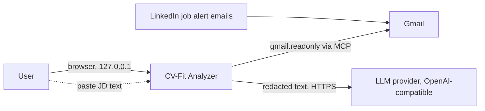

### 8.2 Runtime view

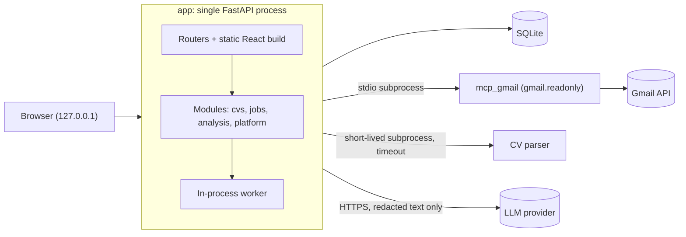

Two long-running processes only: `app` and `mcp_gmail`. The CV parser is a short-lived subprocess with a timeout (isolation for untrusted files), not a service. Job-post text enters only by user paste; no component contacts LinkedIn.

### 8.3 Module view

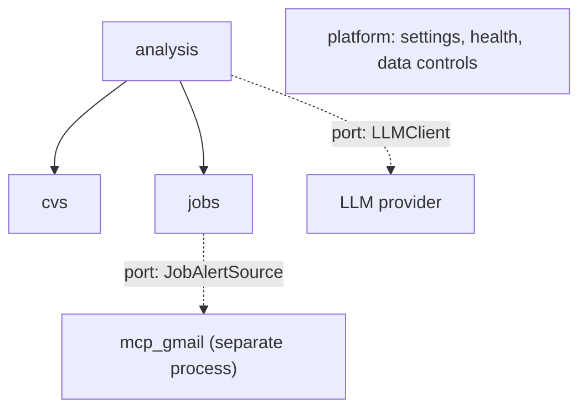

Layering inside every module:

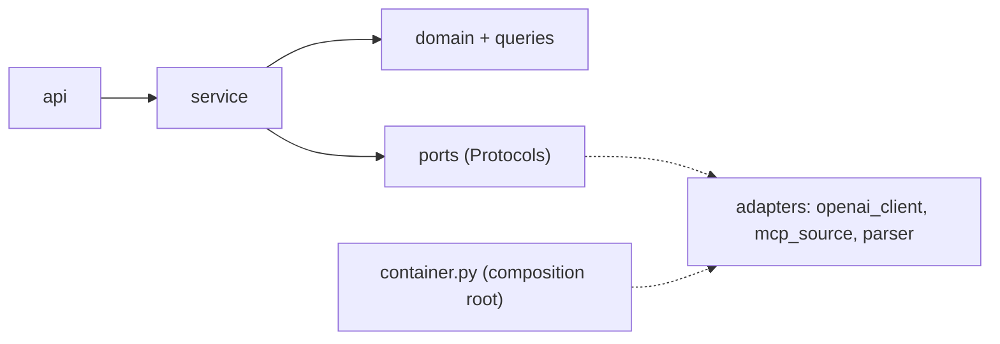

Rules:

- Each module owns its tables. Other modules call only its `service.py`, never its tables or internals.
- Dependency direction is one-way: `analysis -> (cvs, jobs)`. `platform` is standalone. The `benchmarks` module is deferred (Could); when built it depends on `analysis` only.
- External systems (LLM, Gmail, file parser, clock) are reached through small Protocols defined by the consumer and wired in `container.py`.
- The rules are enforced by an automated test (see section 10).

### 8.4 Technology decisions

| Concern              | Decision                                                                           | Rationale                                                                                                               |
| -------------------- | ---------------------------------------------------------------------------------- | ----------------------------------------------------------------------------------------------------------------------- |
| Backend              | Python 3.13, FastAPI, Pydantic v2, uv                                              | Shared models for API and LLM output validation.                                                                        |
| DB                   | SQLite + SQLAlchemy 2 + Alembic                                                    | Single user; Postgres by URL change later.                                                                              |
| Tasks                | Task table in SQLite + in-process async worker                                     | No Redis, Celery or message broker.                                                                                     |
| Gmail integration    | One MCP server `mcp_gmail` (Python `mcp` SDK, stdio)                               | The only component holding OAuth credentials: real process isolation. Invoked by backend code, never exposed to an LLM. |
| LLM                  | OpenAI SDK against configurable `base_url`                                         | Provider swap without code change.                                                                                      |
| Frontend             | React, Vite, TypeScript, TanStack Query, Radix UI + Tailwind (CSS-variable tokens) | Built to static files served by FastAPI; no SSR needed.                                                                 |
| Progress             | Polling every 1–2 s                                                                | Simpler than SSE for one user.                                                                                          |
| Parsing              | pymupdf (PDF), python-docx (DOCX), in a subprocess with timeout                    | Isolation from parser bugs.                                                                                             |
| Packaging            | Native run: `uv` + `npm`                                                           | Containers cannot reach the OS keychain; Docker is Could.                                                               |
| Secrets              | OS keychain via `keyring`; `.env` for non-secrets                                  | No secrets in repo.                                                                                                     |
| Boundary enforcement | import-linter or a pytest import test                                              | Keeps module dependency direction honest.                                                                               |

### 8.5 Data model

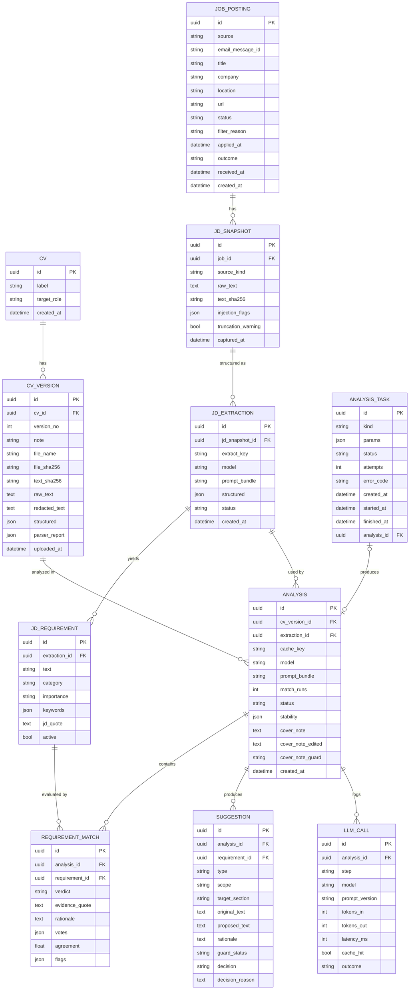

Notes:

- `LLM_CALL` stores metadata only, never prompts or content.
- Scores, the fit summary and constraint flags are derived at read time from `REQUIREMENT_MATCH`, `JD_REQUIREMENT.active`, the structured JD and the user's settings; they are never stored.
- `JD_EXTRACTION` is keyed by `extract_key`, so the same job post analyzed with several CV versions reuses one requirement set.
- Deferred (Could): `BENCHMARK_SET`, `BENCHMARK_MEMBER`, `GOLD_LABEL`. In MVP, gold labels are YAML files under `eval/gold/`.

### 8.6 Class diagrams

**Domain model**

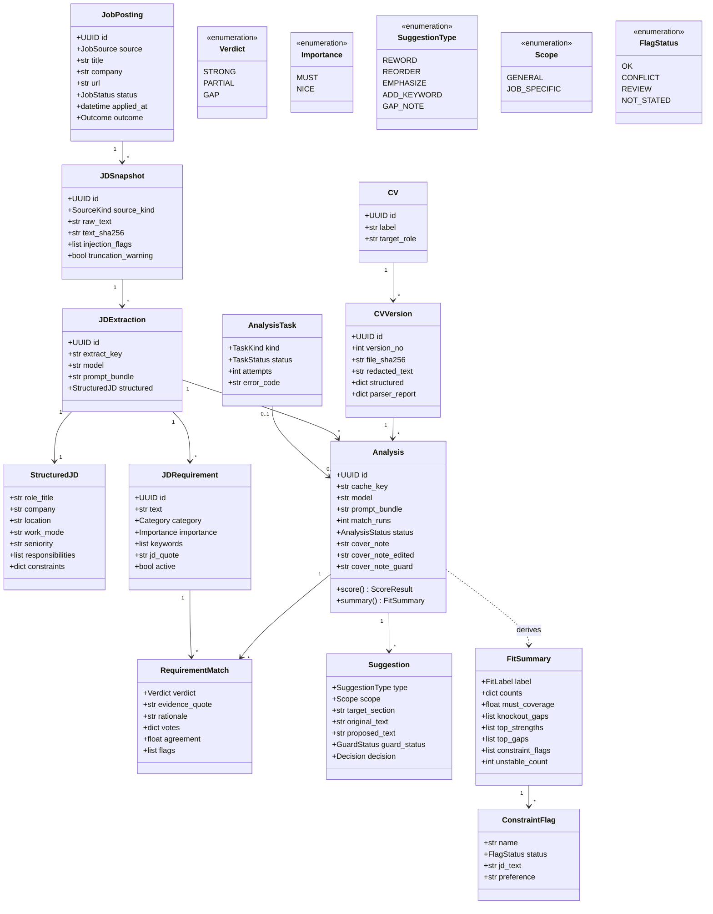

**Service layer**

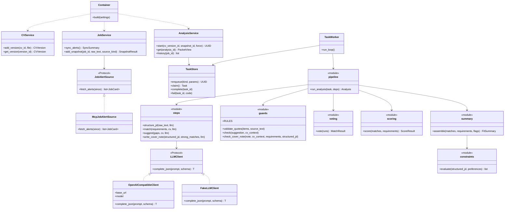

Stateful or boundary-facing things are classes or Protocols; pure logic (steps, guards, voting, scoring, summary, constraints) is plain typed functions grouped in modules. A `ComparisonService` returns only if benchmarks are built (Could).

### 8.7 State machines

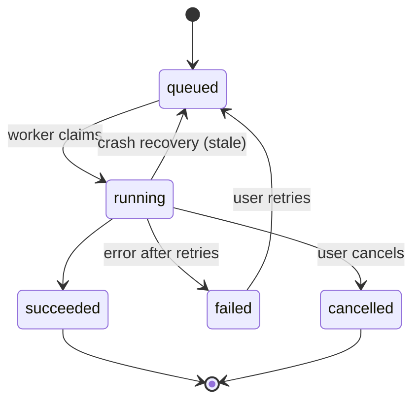

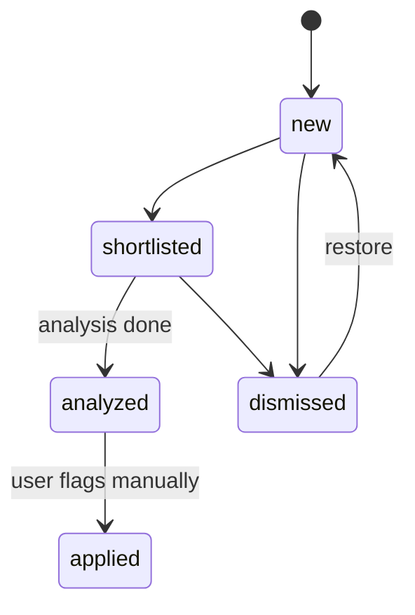

### 8.8 Analysis pipeline specification

**Inputs:** `cv_version.redacted_text` + structured sections; `jd_snapshot.raw_text` (raw, possibly a whole pasted page).
**Principle:** LLM calls that read JD or CV text have no tools attached. Order of steps is fixed in code.

| Step | Name                  | Executor                                                         | Output                                                                                                                                                                                                                                                                                                                                                                                                                                                                                                             |
| ---- | --------------------- | ---------------------------------------------------------------- | ------------------------------------------------------------------------------------------------------------------------------------------------------------------------------------------------------------------------------------------------------------------------------------------------------------------------------------------------------------------------------------------------------------------------------------------------------------------------------------------------------------------ |
| S0   | Preflight             | code                                                             | Size checks, hashes, injection and truncation heuristics, cache lookup.                                                                                                                                                                                                                                                                                                                                                                                                                                            |
| S1   | Structure and extract | LLM, once per `extract_key`                                      | `{is_job_description, job_count, role_title, company, location, work_mode, seniority, responsibilities[{text, jd_quote}], requirements[{text, category, importance, keywords[], jd_quote}], constraints{languages[], salary_text, work_authorization_text, onsite_text}}`. Code then: not a job description → `JD_NOT_FOUND`; more than one job → `JD_MULTIPLE_JOBS`; every quote must be a substring of the pasted text; duplicates merged; keep 8–40 requirements by importance (fewer than 5 raises a warning). |
| S2   | Match                 | LLM × N runs (default 3, concurrent up to `LLM_MAX_CONCURRENCY`) | Per requirement: `{requirement_id, verdict, evidence_quote, rationale ≤ 40 words}`.                                                                                                                                                                                                                                                                                                                                                                                                                                |
| S3   | Ground                | code                                                             | Quote must occur in the redacted CV (normalized); otherwise verdict = gap, flag `ungrounded_evidence`.                                                                                                                                                                                                                                                                                                                                                                                                             |
| S4   | Vote                  | code                                                             | Majority per requirement; tie → more conservative verdict; `agreement = winning_votes / N`; below 0.67 → `unstable`.                                                                                                                                                                                                                                                                                                                                                                                               |
| S5   | Suggest               | LLM                                                              | Suggestions for partial and gap requirements that have adjacent CV evidence; `gap_note` for gaps with none. Each tagged `general` (improves the master CV regardless of employer) or `job_specific` (reorder or emphasize for this post).                                                                                                                                                                                                                                                                          |
| S6   | Fabrication guard     | code                                                             | See rules below.                                                                                                                                                                                                                                                                                                                                                                                                                                                                                                   |
| S7   | Cover note            | LLM                                                              | `{note, claims[{text, evidence_quote}]}` built from the structured JD (role, company, top must-haves) and strong matches only.                                                                                                                                                                                                                                                                                                                                                                                     |
| S8   | Cover note guard      | code                                                             | See rules below; one regeneration attempt that includes the violation, then flag.                                                                                                                                                                                                                                                                                                                                                                                                                                  |
| S9   | Persist               | code                                                             | Analysis, matches, suggestions, cover note, LLM call metadata, events.                                                                                                                                                                                                                                                                                                                                                                                                                                             |

**Keys**

- `extract_key = sha256(jd_text_sha256 | prompt_bundle | model)`. The requirement set is reused across every CV version, so re-running after a CV edit changes only the matches.
- `cache_key = sha256(cv_text_sha256 | extract_key | prompt_bundle | model | match_runs | params)`.
- `prompt_bundle` = hash of the prompt files and output schemas under `prompts/`.

**Scoring (derived at read time, tunable via eval)**

- Weights: must = 3, nice = 1. Values: strong = 1.0, partial = 0.5, gap = 0.
- `coverage = Σ(weight × value) / Σ(weight)` over active requirements, shown as a rounded integer.
- `must_have_coverage = strong_or_partial_must / total_must` (also shown as counts).
- `knockout_gaps` = active must-have requirements with verdict gap.
- Fit label: **Strong fit** if coverage ≥ 80 and no knockout gaps; **Reasonable fit** if coverage ≥ 60 and at most one knockout gap; otherwise **Stretch**. Thresholds are placeholders until the eval exists.
- Never displayed as a gauge or as hiring probability.

**Fit summary assembly (code only, no LLM prose)**

- Fit label, strong/partial/gap counts, must-have coverage, knockout gap list.
- Strongest matches: up to 3 strong must-have requirements, in JD order.
- Biggest gaps: up to 3 gap must-have requirements, then partial must-haves, in JD order.
- Constraint flags and unstable count.

**Constraint flags (code, deterministic)**

- Compared: languages, work mode (remote, hybrid, onsite), locations, salary, work authorization.
- Statuses: `ok`, `conflict`, `review` (JD states something the user must judge, for example a salary), `not_stated`.
- Flags are informational. They never skip or block a job.

**Fabrication guard rules for CV suggestions (deterministic)**

1. Every number in `proposed_text` must already appear in the CV text.
2. Employer names, product names, technologies and certifications not present in the CV vocabulary are rejected, except `add_keyword` suggestions whose requirement has a grounded verdict of partial or strong.
3. `gap_note` suggestions may not contain rewrite text.
4. A violating suggestion gets `guard_status = rejected_<rule>`, is hidden by default and counted in provenance.

**Cover note guard rules (deterministic)**

1. Language English; 60–150 words (`COVER_NOTE_MIN_WORDS`, `COVER_NOTE_MAX_WORDS`).
2. Every number must appear in the CV text.
3. Proper nouns must come from the CV vocabulary, or be the company or role title from the structured JD. No invented recipient names.
4. Every `claims[].evidence_quote` must be a substring of the redacted CV text.
5. No keyword belonging to a requirement with verdict gap or partial may appear in the note (it may only assert strong matches).
6. A banned-phrase list (generic enthusiasm and filler phrases) must not match.
7. Failure after one regeneration → `cover_note_guard = rejected_<rule>`; the UI shows "Draft could not be verified" with a retry action.

**Prompt-injection posture:** JD and CV are wrapped in delimiters and labeled as untrusted data; no tools are attached; output must validate against the Pydantic schema; injection phrases only raise a visible flag, they are not the defense. The cover note guard also protects against instructions smuggled into the job post.

### 8.9 API surface (REST, JSON)

| Area         | Endpoint                                                                               | Notes                                                                                     |
| ------------ | -------------------------------------------------------------------------------------- | ----------------------------------------------------------------------------------------- |
| CV           | `POST /api/cvs`, `GET /api/cvs`                                                        | Create/list CV labels.                                                                    |
|              | `POST /api/cvs/{id}/versions`                                                          | Multipart upload.                                                                         |
|              | `GET /api/cv-versions/{id}`, `GET /api/cv-versions/{id}/parser-view`                   | Detail, Parser View.                                                                      |
|              | `DELETE /api/cv-versions/{id}`                                                         | Cascade.                                                                                  |
| Jobs         | `POST /api/jobs/sync-alerts`                                                           | Gmail sync via MCP.                                                                       |
|              | `GET /api/jobs?status=`, `POST /api/jobs`, `PATCH /api/jobs/{id}`                      | List, manual add, status, applied_at and outcome.                                         |
|              | `POST /api/jobs/{id}/snapshots`                                                        | Body `{raw_text, source_kind}`; returns snapshot plus warnings.                           |
|              | `GET /api/jobs/{id}/history`                                                           | Analyses of this job across CV versions.                                                  |
| Analysis     | `POST /api/analyses`                                                                   | 200 with existing id on cache hit, otherwise 202 + task id. `?force=true` bypasses cache. |
|              | `GET /api/tasks/{id}`, `POST /api/tasks/{id}/cancel`                                   | Polled every 1–2 s; cancel.                                                               |
|              | `GET /api/analyses/{id}`                                                               | Full packet: structured JD, summary, matches, suggestions, cover note, provenance.        |
|              | `GET /api/analyses/{id}/export.md`                                                     | Whole packet as Markdown (summary, matches, gaps, accepted suggestions, cover note).      |
|              | `PATCH /api/suggestions/{id}`, `PATCH /api/requirements/{id}`                          | Accept/reject, activate/deactivate.                                                       |
|              | `PATCH /api/analyses/{id}/cover-note`, `POST /api/analyses/{id}/cover-note/regenerate` | Edit, regenerate.                                                                         |
| Settings/Ops | `GET/PUT /api/settings`                                                                | Includes criteria and non-negotiables.                                                    |
|              | `POST /api/gmail/connect`, `POST /api/gmail/disconnect`                                |                                                                                           |
|              | `GET /api/health`, `POST /api/backup`, `POST /api/data/purge`, `GET /api/data/export`  |                                                                                           |

Deferred (Could): benchmark and compare endpoints, CV text diff, usage endpoint, URL fetch endpoint. Errors use a single envelope `{code, message, details, request_id}` with stable error codes (section 8.11).

### 8.10 MCP server contract

| Server      | Tool              | Input                         | Output                                                            |
| ----------- | ----------------- | ----------------------------- | ----------------------------------------------------------------- |
| `mcp_gmail` | `list_job_alerts` | `since: datetime, limit: int` | message ids + received_at                                         |
|             | `get_job_alert`   | `message_id: str`             | parsed job cards (title, company, location, url) + parse warnings |

Two tools in total. Gmail scope is `gmail.readonly`; tokens live in the OS keychain. Alert-email parsing lives inside this server because only it knows the email layout; the backend receives job cards and does normalization, deduplication and pre-filtering. There is no CV-data MCP tool: the backend owns CV data and reads it directly. The server is invoked by backend code only and is never exposed to an LLM.

### 8.11 Reliability and error handling

| Code                      | Cause                                    | Behavior                                                                             |
| ------------------------- | ---------------------------------------- | ------------------------------------------------------------------------------------ |
| `LLM_TIMEOUT`             | Provider slow                            | Retry 3× with backoff 2 s / 8 s / 30 s, then fail the step.                          |
| `LLM_RATE_LIMIT`          | 429                                      | Honor `Retry-After`, then backoff.                                                   |
| `LLM_AUTH`                | Bad key                                  | No retry; surface in UI and Health.                                                  |
| `LLM_SCHEMA_INVALID`      | Output fails Pydantic                    | Up to 2 repair retries, then fail the step.                                          |
| `GMAIL_AUTH_EXPIRED`      | Token revoked                            | Prompt reconnect; no data loss.                                                      |
| `ALERT_PARSE_FAILED`      | Unknown email layout                     | Record message id, skip, show count.                                                 |
| `CV_PARSE_LOW_YIELD`      | Little text extracted                    | Warn; analysis requires user confirmation.                                           |
| `TASK_STALE`              | Worker crashed                           | Requeue tasks `running` beyond timeout.                                              |
| `BUDGET_EXCEEDED`         | Monthly cap                              | Block new tasks; allow explicit override.                                            |
| `COMPARE_INVALID` (Could) | Model/prompt/runs/requirements differ    | Show reason; refuse delta computation.                                               |
| `JD_NOT_FOUND`            | Pasted text contains no job description  | Stop before matching; no LLM matching cost; tell the user what was received.         |
| `JD_MULTIPLE_JOBS`        | Page lists several distinct jobs         | Stop; ask the user to paste a single job.                                            |
| `JD_TRUNCATED_SUSPECTED`  | Heuristic detects likely cut-off text    | Warn at save time; the user may continue.                                            |
| `COVER_NOTE_REJECTED`     | Cover note failed the guard twice        | Show "Draft could not be verified" with retry; the rest of the packet is unaffected. |
| `FETCH_HOST_BLOCKED`      | URL host is a blocked or private address | Refuse with an explanation (Could, FR-34).                                           |

Concurrency: LLM calls limited by a semaphore (default 2). Tasks are idempotent by `cache_key`.

### 8.12 Security architecture

| Threat                              | Control                                                                                                                                                             |
| ----------------------------------- | ------------------------------------------------------------------------------------------------------------------------------------------------------------------- |
| Server-side URL fetch (SSRF, Could) | LinkedIn hosts always blocked; loopback, link-local and private address ranges blocked; redirects re-checked; size and time limits; no cookies or credentials sent. |
| Accidental LinkedIn access          | A single HTTP client wrapper with a host blocklist (`BLOCKED_FETCH_HOSTS`, default includes linkedin.com); a unit test asserts it refuses LinkedIn URLs.            |
| Prompt injection via JD/email       | No tools on analysis calls; MCP invoked by code only; delimiters; schema validation; never render LLM output as raw HTML.                                           |
| PII leaves machine                  | Redaction preview; custom terms; provider retention policy checked before choosing a provider.                                                                      |
| Malicious upload                    | Size/type/magic-byte checks; subprocess parsing with timeout; `pip-audit`.                                                                                          |
| Browser-to-localhost attacks        | Bind 127.0.0.1; CORS allowlist; `TrustedHostMiddleware` (DNS rebinding).                                                                                            |
| Secret leakage                      | `keyring` (the reason the app runs natively, not in Docker); `.gitignore` for data/CV/`.env`; `gitleaks` pre-commit; Gmail scope readonly.                          |
| Data at rest                        | Disk encryption; delete/purge; encrypted backups; no content in logs.                                                                                               |
| Supply chain                        | Lockfiles; `npm audit`; Dependabot; third-party skills/hooks read and pinned before enabling.                                                                       |

### 8.13 Observability and cost

JSON logs with fields `ts, level, request_id, task_id, step, outcome, latency_ms, tokens_in, tokens_out`, never content. Per-call metadata (step, model, prompt version, tokens, latency, cache hit, outcome) is stored in `llm_call`. The monthly token budget check sums stored token counts. A usage and cost dashboard is Could (FR-27).

### 8.14 Configuration

| Variable                                        | Default                 | Purpose                                        |
| ----------------------------------------------- | ----------------------- | ---------------------------------------------- |
| `COVER_NOTE_MIN_WORDS` / `COVER_NOTE_MAX_WORDS` | 60 / 150                | Cover note length bounds enforced by the guard |
| `BLOCKED_FETCH_HOSTS`                           | `linkedin.com`          | Hosts the backend must never contact           |
| `LLM_BASE_URL`                                  | provider URL            | OpenAI-compatible endpoint                     |
| `LLM_MODEL`                                     | `deepseek-v4-flash`     | Model string recorded per analysis             |
| `LLM_API_KEY`                                   | keychain                | Never in a committed `.env`                    |
| `MATCH_RUNS`                                    | 3                       | Voting runs (1–5)                              |
| `LLM_MAX_CONCURRENCY`                           | 2                       | Semaphore size                                 |
| `DATABASE_URL`                                  | `sqlite:///data/app.db` | Swap to Postgres later                         |
| `ALLOWED_HOSTS` / `ALLOWED_ORIGINS`             | localhost               | Host and CORS allowlists                       |
| `GMAIL_CLIENT_SECRET_PATH`                      | —                       | OAuth client file, outside repo                |
| `GMAIL_MCP_COMMAND`                             | `python -m mcp_gmail`   | Command that starts the MCP subprocess         |
| `TOKEN_BUDGET_MONTHLY`                          | set by user             | Cost guard                                     |
| `DATA_DIR`                                      | `./data`                | DB, uploads, backups (gitignored)              |

### 8.15 Repository structure

```
cv-fit/

├─ AGENTS.md
├─ md
│  ├─PRD.md
│  ├─DESIGN.md
│  ├─AFD.md
├─ .agents/skills/
├─ backend/
│  ├─ app/
│  │  ├─ main.py            FastAPI app, routers, static UI
│  │  ├─ container.py       composition root (manual constructor injection)
│  │  ├─ config.py  db.py
│  │  ├─ shared/            error types and small utilities only
│  │  └─ modules/
│  │     ├─ cvs/            api.py service.py parser.py redactor.py models.py queries.py
│  │     ├─ jobs/           api.py service.py jd_input.py prefilter.py ports.py mcp_source.py models.py queries.py
│  │     ├─ analysis/       api.py service.py pipeline.py steps.py guards.py scoring.py voting.py
│  │     │                  summary.py constraints.py ports.py openai_client.py tasks.py worker.py
│  │     │                  models.py queries.py
│  │     └─ platform/       settings, health, data controls
│  ├─ mcp_gmail/            server.py alert_parser.py (separate process)
│  ├─ prompts/              jd_structure.v1.md  match.v1.md  suggest.v1.md  cover_note.v1.md
│  ├─ eval/                 cases/, gold/*.yaml, reports/
│  ├─ scripts/              backup
│  └─ tests/                unit, integration, security, architecture, fixtures
├─ frontend/
└─ .env.example
```

The `benchmarks` module is not created until FR-18–21 are promoted from Could.

### 8.16 Architecture principles and guardrails

**ADR-001: modular monolith, not microservices**

- _Context:_ one user, one machine, a few analyses per week, one developer.
- _Decision:_ one FastAPI process with five modules, plus one helper process (`mcp_gmail`) that isolates OAuth credentials.
- _Why not microservices:_ their benefits (independent deployment, per-service scaling, team autonomy) do not apply here; their costs (network failures, inter-service auth, contract versioning, distributed tracing, data consistency between CV and JD, multiple deploy units) all would.
- _Consequences:_ module boundaries are enforced in code instead of by the network. A module can be extracted into a service later.
- _Extraction triggers:_ more than one user, the pipeline needing different scaling or hardware than the API, or a second team. Without one of these, do not extract.

**Module rules**

1. Each module owns its tables and exposes only `service.py`.
2. Allowed dependencies: `analysis -> (cvs, jobs)`; `platform` standalone. A future `benchmarks` module may depend only on `analysis`.
3. No cross-module table access or imports of internals; verified by an automated test.

**SOLID in practice (Python: functions and Protocols, not class hierarchies)**
| Principle | Applied as | Avoid |
|---|---|---|
| S | One reason to change per module/class; orchestration functions only orchestrate; scoring only scores; grounding only validates quotes. | A service that uploads, parses, redacts, stores and calls the LLM. |
| O | Variation points are lists of functions (guard rules, redaction rules, alert-layout parsers). Add a function to the list, do not edit the engine. | Making everything pluggable. |
| L | Fakes honor the real contract, including the error types they raise (`LLMError`); provider exceptions never leak past the adapter. | Tests that pass with a fake and fail with the real client. |
| I | Ports are small (one or two methods); pure logic receives small dataclasses, not ORM objects. | Wide interfaces forcing consumers to know unused methods. |
| D | Business logic depends on Protocols for LLM, Gmail, file parsing and clock; wiring happens only in `container.py`. | A DI framework; abstractions for internal things with one implementation. |

If SOLID and simplicity conflict, simplicity wins unless the cost of change is demonstrated.

**Guardrails against over-engineering**

1. Create an abstraction only for (a) an external-system boundary, or (b) two real implementations that exist today. Otherwise wait for the third use.
2. Not to be built: message broker, event bus, CQRS, API gateway, service mesh, Kubernetes, DI framework, generic repository base classes, plugin systems, feature flags, Redis, extra cache layers.
3. Complexity budget: at most 4 modules in MVP (cvs, jobs, analysis, platform), 2 long-running processes, 1 database. A new dependency needs a one-line justification.
4. Size alarms: files over about 300 lines or functions over about 40 lines are discussed. Non-test backend code for Stage A above roughly 2,000–3,000 lines is a warning sign (heuristic, not a standard).
5. Every implementation plan states the simplest design considered first and ends with "What I deliberately did not build".
6. Nothing outside the Must list is built before Stage A passes the eval gate.

**ADR-002: job-post intake by user-initiated paste; no LinkedIn access by the application**

- _Context:_ the user wants the system to read the job description, responsibilities and requirements automatically. Alert emails carry only title, company, location and a link. LinkedIn's help pages prohibit third-party software, including crawlers, bots, plug-ins and browser extensions, that scrapes, modifies or automates activity on its site, and warn of account restriction.
- _Options considered:_
  | Option | Verdict |
  |---|---|
  | Backend fetches LinkedIn job URLs | Rejected: crawler/bot behavior; also blocked by login walls |
  | Browser extension reading the page | Rejected: prohibited category |
  | Browser agent in the logged-in session | Rejected |
  | User pastes the whole page; LLM structures it (FR-09, FR-29) | **Accepted** |
  | Fetch non-LinkedIn career pages by URL (FR-34) | Could; static pages only; SSRF controls required |
  | Alert snippets | Pre-filter only |
- _Decision:_ automate understanding, not retrieval. The user copies the page text in one gesture; the system extracts and verifies the structure. A host blocklist in the only HTTP client wrapper makes NG1 enforceable in code.
- _Consequences:_ about three seconds of manual effort per job post; robustness depends on the quality of S1 and on quote verification; truncated copies are detected heuristically and flagged.
- _Revisit triggers:_ LinkedIn offers an official personal-use data export or API for job posts; or an official partner integration becomes available. A change in effort alone is not a trigger.

## 9. Sequence Diagrams

### SD-1 Upload and parse a CV

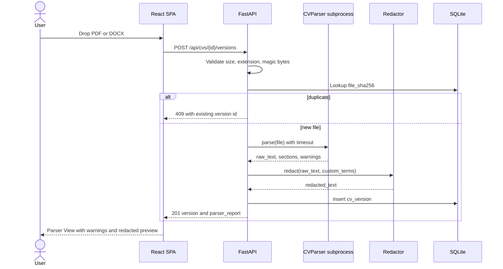

### SD-2 Sync job alerts

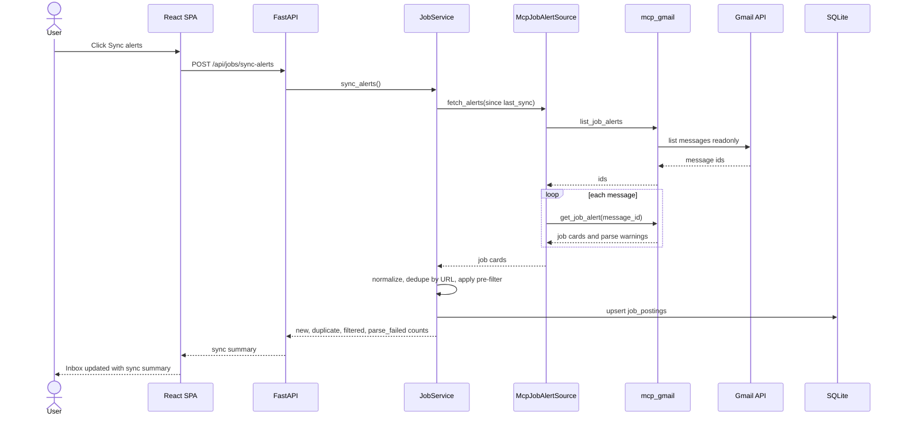

### SD-3 Run an analysis and build the packet

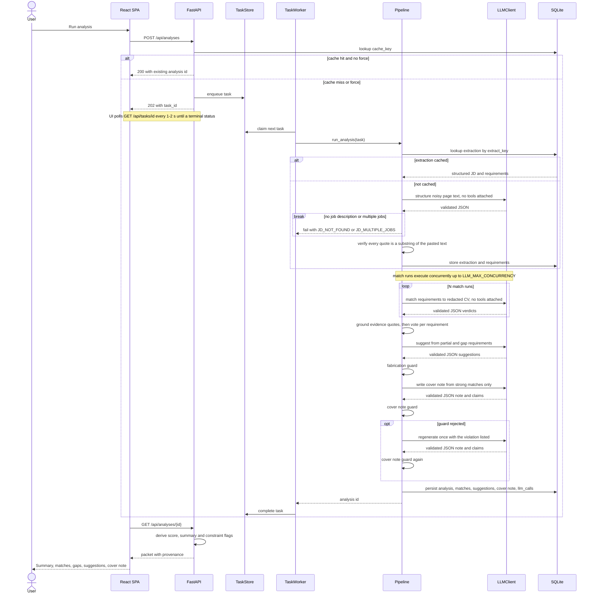

### SD-4 Compare two CV versions

> **Deferred (Could):** SD-4 (compare two CV versions) is not part of the MVP. Keep the diagram for reference; it returns with FR-18–21.

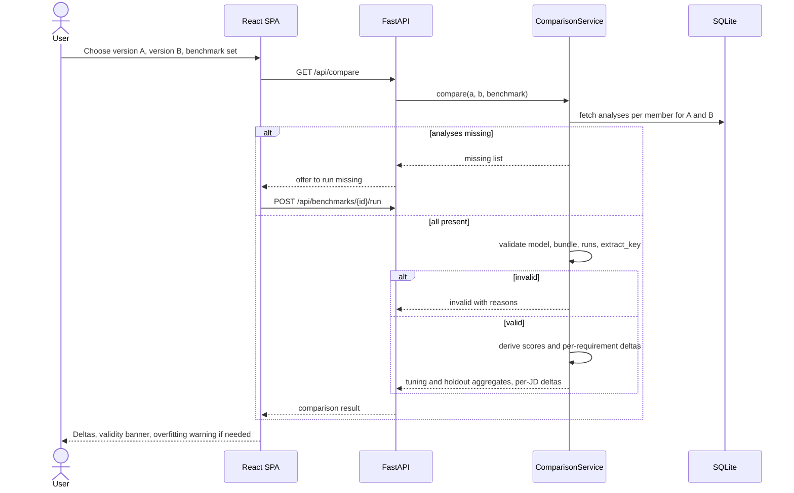

### SD-5 Decide on suggestions, edit the cover note and export the packet

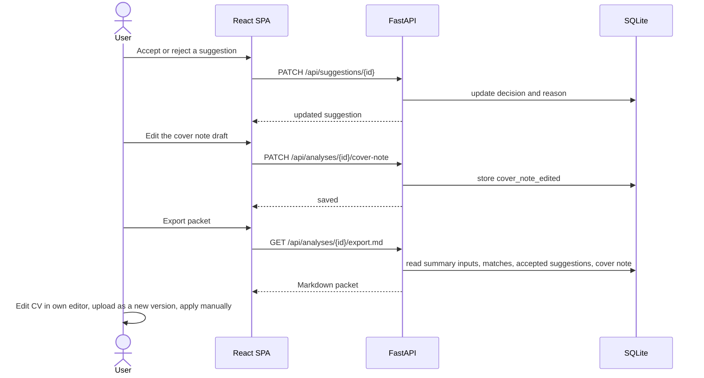

### SD-6 Add a job post by paste

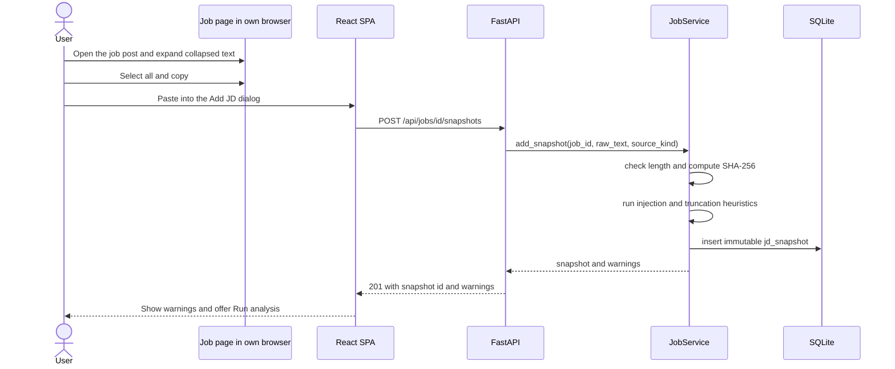

Nothing in this flow contacts LinkedIn: the only access to the job page is the user's own browser and clipboard.

## 10. Testing and Evaluation

| Layer                   | Content                                                                                                                                                                                                                            |
| ----------------------- | ---------------------------------------------------------------------------------------------------------------------------------------------------------------------------------------------------------------------------------- |
| Unit                    | Redactor, grounding, fabrication guard, cover note guard, voter, scorer, summary assembly, constraint evaluation, cache keys, alert parser in `mcp_gmail` (fixtures from real emails, kept local).                                 |
| Integration             | Pipeline with a fake `LLMClient`; task queue crash recovery; migrations; MCP server against fixtures.                                                                                                                              |
| Contract                | OpenAPI schema snapshot; MCP tool schemas; LLM output schemas.                                                                                                                                                                     |
| JD structuring fixtures | At least 15 real pasted pages kept local: clean, noisy (similar jobs, footers), multiple jobs, truncated, not-a-job, and non-English. Assert quote substring checks, correct refusals and zero boilerplate items.                  |
| Security                | Injection corpus in JD/email text (including instructions aimed at the cover note) must not change tool use, leak data or pass the guard; upload fuzz cases; Host/CORS checks; no PII in logs; HTTP client refuses LinkedIn hosts. |
| Adversarial             | Suggestion and cover-note cases designed to tempt fabrication (invented metrics, tools, employers); guards must reject all.                                                                                                        |
| Eval                    | 10–15 CV+JD pairs with gold labels in `eval/gold/*.yaml`; run via CLI; report agreement, stability, ungrounded rate, structuring accuracy, cost.                                                                                   |
| Architecture            | Automated check (import-linter or pytest) that modules import each other only through `service.py` and only in the allowed direction.                                                                                              |
| E2E (Stage B)           | Playwright against localhost for core flows.                                                                                                                                                                                       |

**Regression gate:** any change to prompts, model string or scoring must run the eval; agreement may not drop more than 2 percentage points, and stability and structuring accuracy may not fall below target. Eval results are stored with the prompt bundle hash.

## 11. Risks

| Risk                                          | Impact                                  | Mitigation                                                                                                        |
| --------------------------------------------- | --------------------------------------- | ----------------------------------------------------------------------------------------------------------------- |
| LLM judgment is noisy                         | Misleading verdicts                     | Voting, agreement flags, grounding, gold-label eval.                                                              |
| Pasted page contains noise or several jobs    | Wrong requirements                      | Quote verification, `JD_NOT_FOUND` and `JD_MULTIPLE_JOBS`, review panel in the packet, real-page fixtures.        |
| Copied text misses collapsed content          | Missing requirements                    | Truncation heuristic warning; instruct the user to expand text first; verify with real samples.                   |
| Cover note contains unsupported claims        | Misrepresentation in a real application | Strong-matches-only input, deterministic guard, banned phrases, "Draft" label, user review.                       |
| Optimizing for the tool score distorts the CV | Dishonest or keyword-stuffed CV         | Coverage framing, fabrication guard, honest UI copy, no apply/skip verdicts.                                      |
| Overlap with LinkedIn's own Job Match         | Limited added value                     | Differentiate on verbatim evidence, grounding and guards, local history, cover note, privacy; reassess if unused. |
| Alert email layout changes                    | Sync breaks                             | Fixture tests, explicit parse-failure counts, manual add fallback.                                                |
| Model alias changes silently                  | Incomparable history                    | Record model string; mark history entries not comparable.                                                         |
| PII sent to provider                          | Privacy breach                          | Redaction preview, retention review, provider choice via base URL.                                                |
| Building tooling instead of applying          | Wasted weeks                            | Timeboxes, Stage A gate, metric M7.                                                                               |
| Third-party skill/hook compromise             | Local code execution                    | Read before enabling, pin versions.                                                                               |

## 12. Milestones (rough timeboxes for one developer)

| Stage | Step | Deliverable                                                            | Timebox |
| ----- | ---- | ---------------------------------------------------------------------- | ------- |
| A     | A1   | Schemas, fixtures, DB migrations                                       | 1–2 d   |
| A     | A2   | CV parse + redaction (FR-01–03)                                        | 1–2 d   |
| A     | A3   | JD intake and structuring on real pasted pages (FR-08, 09, 29)         | 2 d     |
| A     | A4   | Match + grounding + voting + scoring + summary (FR-12–15, 30)          | 2–3 d   |
| A     | A5   | Suggestions + fabrication guard (FR-16)                                | 1–2 d   |
| A     | A6   | Cover note + guard + packet export (FR-32)                             | 1–2 d   |
| A     | A7   | Tasks, cache, eval CLI with YAML gold (FR-11, 17, 23)                  | 1–2 d   |
| A     | A8   | Gmail MCP + alert parser + pre-filter (FR-06, 07)                      | 1–2 d   |
| A     | Gate | Metrics M1–M4 and M8 met on the eval set                               | —       |
| B     | B1   | App shell, CV library, Parser View                                     | 2 d     |
| B     | B2   | Job Inbox, Add JD dialog, structured-JD check                          | 2 d     |
| B     | B3   | Packet screen: summary, matches, gaps, suggestions, cover note, export | 3–4 d   |
| B     | B4   | Settings (including non-negotiables), minimal health, data controls    | 1–2 d   |
| B     | B5   | Hardening, accessibility pass, E2E                                     | 2 d     |

Estimates are rough and should be re-based after A1.

## 13. Open Questions

1. Real alert-email format and whether snippets carry anything useful (collect 5–10 samples before writing the parser).
2. Real pasted-page behavior: does copy-all include the full description, or is part hidden behind collapsed controls? Collect 15 real pages (local only) before finalizing the S1 prompt and the truncation heuristics.
3. Initial fit-label thresholds (80/60) are placeholders until the eval exists.
4. Default `MATCH_RUNS`: 3 (stability) or 1 (speed)? Decide after measuring Stage A latency.
5. Are both suggestion scopes (`general`, `job_specific`) useful? If only one, drop the `scope` field.
6. Which non-negotiables to support at MVP (languages, salary floor, work mode, locations, work authorization)?
7. Confirm outcome tracking fields (`applied_at`, `outcome`) and statuses.
8. Which LLM provider endpoint, given retention and data-location differences?
9. How many CV labels (target roles) will exist?
10. Data retention default (keep forever vs. auto-purge).
11. Scheduled sync vs. manual only.
12. Baselines before development: minutes per application, applications per week, response rate (feeds M7).
13. Should LinkedIn profile suggestions (headline, About) be promoted from Could?

## 14. Glossary

- **Application packet:** the per-job output of one analysis: fit summary, matches, gaps, CV suggestions and cover note draft.
- **JD snapshot:** immutable captured text of a job post as pasted.
- **Structured JD:** role, company, constraints, responsibilities and requirements extracted from a snapshot, each with a verified quote.
- **Requirement set:** requirements extracted from one snapshot under one prompt bundle and model (`extract_key`).
- **Grounded:** evidence quote verified as present in the source text.
- **Constraint flag:** informational comparison between a user non-negotiable and what the job post states.
- **Prompt bundle:** hash of all prompt files and output schemas.
- **Holdout (Could):** benchmark JDs never used to guide CV edits, used to detect overfitting.

## 15. Revision History

| Version | Date       | Changes                                                                                                                                                                                                                                                                                                                                                                                                                                                                                       |
| ------- | ---------- | --------------------------------------------------------------------------------------------------------------------------------------------------------------------------------------------------------------------------------------------------------------------------------------------------------------------------------------------------------------------------------------------------------------------------------------------------------------------------------------------- |
| 0.1     | 2026-11-07 | Initial draft.                                                                                                                                                                                                                                                                                                                                                                                                                                                                                |
| 0.2     | 2026-11-07 | Architecture simplified to a modular monolith (ADR-001). Removed `cv_store` MCP server. Single helper process `mcp_gmail`. Native run, no Docker in MVP. Polling instead of SSE.                                                                                                                                                                                                                                                                                                              |
| 0.3     | 2026-11-09 | Refocused on the per-job application packet. Added FR-29 (JD structuring from pasted pages), FR-30 (code-assembled summary), FR-31 (constraint flags), FR-32 (cover note with guard), FR-33 (per-job history and outcome), FR-34 (non-LinkedIn URL fetch, Could). Benchmark and comparison (FR-18–22) moved to Could; gold labels moved to YAML. Modules reduced to four. Added ADR-002 (paste intake, LinkedIn host blocklist). Data model gains `JD_EXTRACTION`; benchmark tables deferred. |
